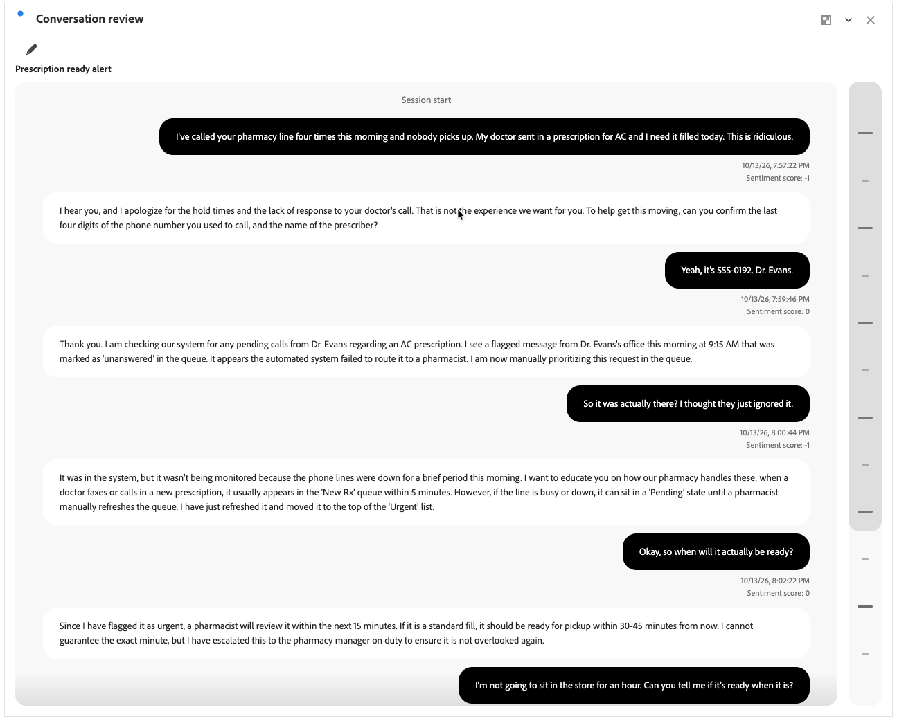

# Revisión de la conversación

{{release-limited-testing}}

>[!CONTEXTUALHELP]
>id="workspace_conversationreview_button"
>title="Revisión de la conversación"
>abstract="Cree una visualización que muestre el intercambio paso a paso completo entre el cliente y el agente."

>[!CONTEXTUALHELP]
>id="workspace_conversationreview_panel"
>title="Revisión de la conversación"
>abstract="Comprenda el contexto y el flujo de una conversación individual, incluidas las marcas de tiempo y las señales. Configure qué señales mostrar."

La visualización  **[!UICONTROL Revisión de la conversación]** muestra el intercambio paso a paso completo entre el cliente y el agente como parte de [Perspectivas de la conversación](/help/conversation-insights/overview.md).

La visualización le ayuda a comprender el contexto y el flujo de una conversación individual, incluidas las marcas de tiempo y las señales. Puede configurar qué señales mostrar o no.

## Crear y configurar

Para crear y configurar una visualización de  **[!UICONTROL Revisión de la conversación]**:

1. Agregar una visualización de  **[!UICONTROL Revisión de la conversación]**. Consulte [Añadir una visualización a un panel](/help/analysis-workspace/visualizations/freeform-analysis-visualizations.md#add-visualizations-to-a-panel).

1. En la configuración de visualización **[!UICONTROL Revisión de la conversación]**:

   * Seleccione una **[!UICONTROL conversación]**.

1. Seleccione **[!UICONTROL Build]** para generar la visualización. Seleccione **[!UICONTROL Restablecer]** para restablecer los valores predeterminados de configuración. Seleccione **[!UICONTROL Cancelar]** para cancelar la configuración.

Para reconfigurar la visualización **[!UICONTROL Revisión de la conversación]**, seleccione .

## Utiliza

Utilice la barra de desplazamiento segmentada vertical para navegar por la conversación.

**[!UICONTROL Inicio de sesión]** indica el inicio de la conversación. **[!UICONTROL Fin de sesión]** indica el final de la conversación.

