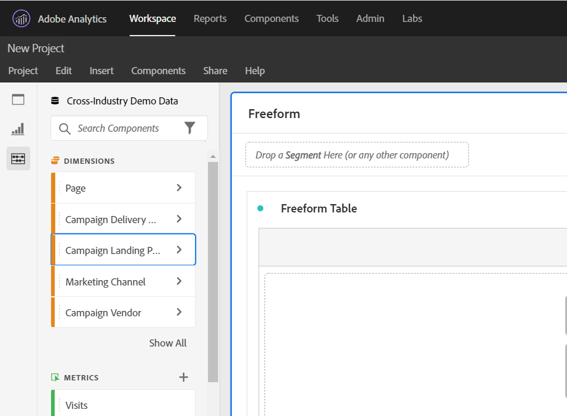

# Accesibilidad en Analysis Workspace

Obtenga información acerca de la compatibilidad con la accesibilidad en [!UICONTROL Analysis Workspace], la herramienta de análisis más importante para Customer Journey Analytics.

La accesibilidad se refiere a hacer que personas con discapacidades visuales, auditivas, cognitivas, motoras y de otro tipo puedan utilizar un producto. Algunos ejemplos de funciones de accesibilidad para productos de software incluyen:

* compatibilidad con lectores de pantalla,
* equivalentes de texto para gráficos,
* métodos abreviados de teclado
* cambio de colores de visualización a alto contraste,
* y más

[!UICONTROL Analysis Workspace] proporciona algunas herramientas de accesibilidad, entre ellas:

## Navegación por teclado

La navegación en [!UICONTROL Analysis Workspace] funciona desde arriba a abajo e izquierda a derecha. Los siguientes elementos de navegación facilitan la accesibilidad:

* La tecla **[!UICONTROL Pestaña]** habilita accesos directos de referencia, moviéndose entre secciones más grandes dentro de Workspace. En el panel izquierdo, **[!UICONTROL Pestaña]** también te permite pasar de una opción arrastrable a la siguiente.
* Los ◀ y ▶ se mueven entre elementos individuales después de que la tecla **[!UICONTROL Pestaña]** haya resaltado un elemento.
* La clave **[!UICONTROL F6]** se desplaza al primer panel del proyecto y se mueve entre las visualizaciones de ese panel. A continuación, se desplaza al siguiente panel del proyecto y se repite.
* Aplicamos indicadores de enfoque para que los usuarios de este tipo de teclados tengan una clara indicación de qué elemento de la interfaz de usuario está seleccionado actualmente. El indicador es un borde azul para el panel seleccionado. Y fondo gris para la funcionalidad seleccionada recientemente y la selección dentro de la funcionalidad. En el ejemplo, [!UICONTROL Componentes] y la dimensión Página se han seleccionado recientemente.

  

### Navegación por teclado para la barra de menús

1. Use el tabulador hasta que haya llegado a la barra de menús.
1. Utiliza las teclas de flecha para desplazarte entre los menús y los elementos de menú.
1. Pulsa **[!UICONTROL Intro]** para abrir un menú o seleccionar un elemento de menú.
1. Usa **[!UICONTROL Esc]** para cerrar un menú.

### Navegación por teclado para interacciones de arrastrar y soltar

[!UICONTROL Analysis Workspace] es una interfaz de usuario de arrastrar y soltar. Sin embargo, los usuarios pueden agregar componentes mediante el teclado:

1. Ir a un componente en el panel izquierdo.
1. Pulsa **[!UICONTROL Intro]** para seleccionar.
1. Utilice las teclas de flecha para desplazarse hasta el área en la que desea soltar el componente.
1. Pulsa **[!UICONTROL Intro]** para colocar el componente.

### Navegación por teclado para columnas de tabla {#table-columns}

Puede cambiar el tamaño y reorganizar las columnas de la tabla con el teclado. Las mismas claves funcionan en macOS y Windows.

#### Redimensionar columnas {#resize-columns}

Puede cambiar el tamaño de las columnas en tablas improvisadas y tablas de cohorte mediante el separador de tamaño de columna, que es el límite entre dos encabezados de columna.

1. Presione **[!UICONTROL Tab]** hasta que el separador de cambio de tamaño de columna esté seleccionado.

   Instrucciones para cambiar el tamaño de la pantalla mientras el separador está seleccionado. Los lectores de pantalla anuncian estas instrucciones y el ancho actual de la columna como porcentaje.

1. Utilice las siguientes claves para cambiar el tamaño de la columna. No se puede cambiar el tamaño de una columna más allá de su anchura mínima o máxima.

   | Clave | Acción |
   | --- | --- |
   | **[!UICONTROL Flecha izquierda]** | Reduzca la columna a la izquierda del separador en 10 píxeles. |
   | **[!UICONTROL Flecha derecha]** | Amplíe la columna a la izquierda del separador en 10 píxeles. |
   | **[!UICONTROL Entrar]** | Restablezca el ancho de la columna. |

#### Reorganizar columnas {#rearrange-columns}

En una tabla de forma libre que puede editar, puede mover una columna a la izquierda o a la derecha mediante el menú **[!UICONTROL Reorganizar]** del encabezado de la columna.

1. Presione **[!UICONTROL Tab]** hasta que el botón **[!UICONTROL Reorganizar]** del encabezado de la columna esté seleccionado.
1. Presione **[!UICONTROL Intro]**, **[!UICONTROL Espacio]** o **[!UICONTROL Flecha abajo]** para abrir el menú.
1. Seleccione **[!UICONTROL Mover columna a la izquierda]** o **[!UICONTROL Mover columna a la derecha]**.

   Para cerrar el menú sin mover la columna, presione **[!UICONTROL Esc]**. El enfoque vuelve al botón **[!UICONTROL Reorganizar]**.

   Después de mover una columna, los lectores de pantalla anuncian su nombre y su nueva posición dentro del grupo.

Tenga en cuenta lo siguiente al reorganizar columnas con el teclado:

* Una columna solo se mueve dentro de su grupo de columnas del mismo nivel, que son las columnas del mismo nivel bajo el mismo encabezado principal. No puede utilizar el teclado para mover una columna a un grupo diferente o para copiar una columna.
* Al mover un encabezado principal, sus columnas y filtros anidados se mueven con él.
* **[!UICONTROL Mover columna a la izquierda]** está deshabilitado para la primera columna de un grupo. **[!UICONTROL Mover columna a la derecha]** está deshabilitado para la última columna de un grupo.
* El botón **[!UICONTROL Reorganizar]** solo está disponible para columnas que también puede reorganizar arrastrando. No está disponible para:
  * Tablas de solo lectura o tablas con interacciones deshabilitadas.
  * Tablas improvisadas con [varias columnas de dimensión](/help/analysis-workspace/visualizations/freeform-table/freeform-table-multidimensions.md), donde no se pueden arrastrar columnas.
  * Columnas de fecha en tablas de cohorte.

### Métodos abreviados de teclado (teclas de acceso directo)

[!UICONTROL Analysis Workspace] ofrece un completo conjunto de [métodos abreviados de teclado (teclas de acceso directo)](/help/analysis-workspace/build-workspace-project/fa-shortcut-keys.md) para lograr un flujo de trabajo más fluido.

## Compatibilidad con lectores de pantalla y ampliadores de pantalla

Un lector de pantalla lee el texto que aparece en la pantalla del equipo. También lee información no textual, como etiquetas de botones o descripciones de imágenes en la aplicación.

## Paletas de color y contraste

[!UICONTROL Analysis Workspace] se esfuerza por lograr la conformidad con WCAG 2.1 AA, incluyendo sus requisitos para el contraste de color.

Además, los usuarios pueden establecer su propia paleta de colores preferida para un proyecto en **[!UICONTROL Proyecto]** > **[!UICONTROL Ajustes del proyecto]** > [Paleta de color del proyecto](/help/analysis-workspace/build-workspace-project/color-palettes.md).

## Validación requerida

Al crear un componente, una visualización o un panel, los campos obligatorios se validan al guardar. Si un campo requerido no supera la validación, se delineará en rojo con un icono de error. Una descripción por escrito explica lo que debe corregirse.

## Compatibilidad con las funciones de accesibilidad del sistema operativo

Analysis Workspace admite funciones de accesibilidad integradas de MS Windows y macOS, como modo de alto contraste, teclas adhesivas y teclas de filtro/teclas lentas. También proporciona información sobre la interfaz de usuario del sistema operativo para habilitar la interacción con tecnologías de asistencia, incluidos lectores de pantalla como VoiceOver para macOS y NVDA en Windows.
