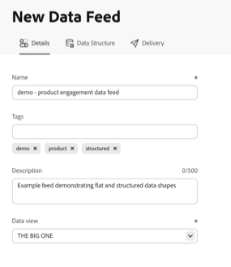

# Creación de un feed de datos

{{release-limited-testing}}

Al crear un feed de datos, debe proporcionar a Adobe lo siguiente:

* La información sobre el destino al que desea enviar los archivos de datos sin procesar

* Los datos que desea incluir en cada archivo

* La frecuencia con la que se envían los datos (incluido el retraso de procesamiento para capturar los eventos que llegan tarde)

Antes de crear un feed de datos, es importante tener una comprensión básica de las fuentes de datos y asegurarse de que cumple todos los requisitos previos. Para obtener más información, consulte [Información general sobre feeds de datos](data-feed-overview.md).

## Crear o configurar una fuente de datos {#create-and-configure-data-feed}

<!-- markdownlint-disable MD034 -->

>[!CONTEXTUALHELP]
>id="cja_datafeed_export_file"
>title="Manifiesto"
>abstract="Elija si desea incluir un archivo de manifiesto con cada entrega de feed de datos. Los archivos de manifiesto contienen información para cada archivo incluido en el feed de datos. Al enviar datos del feed de datos en un solo paquete, también puede optar por incluir un archivo de finalización, pero se recomiendan los archivos de manifiesto. "

<!-- markdownlint-enable MD034 -->

<!-- markdownlint-disable MD034 -->

>[!CONTEXTUALHELP]
>id="cja_datafeed_notify"
>title="Notificar los problemas, cuando se completen y vayan a caducar los datos"
>abstract="Especifique una o varias direcciones de correo electrónico a las que se debe enviar una notificación cuando se haya completado la fuente de datos, cuando esté a punto de caducar o detecten problemas. Separe varias direcciones de correo electrónico con una coma."

<!-- markdownlint-enable MD034 -->

<!-- markdownlint-disable MD034 -->

>[!CONTEXTUALHELP]
>id="cja_datafeed_frequency_granularity"
>title="Frecuencia y granularidad"
>abstract="**Frecuencia de envío** (fuentes activas): la frecuencia con la que se envía la fuente de datos. Los envíos por hora contienen los datos correspondientes a una hora, mientras que los envíos diarios contienen los datos correspondientes a un día. El intervalo de fechas de retroactividad y el retraso en el procesamiento también pueden afectar a los eventos que se incluyen.
**Granularidad** (fuentes de relleno): el intervalo de tiempo que se utiliza para dividir los datos históricos. Cada fragmento contiene los datos correspondientes a un día y se entrega lo más rápido posible, no una vez al día. Este campo siempre se establece en Diario y no se puede modificar.
"

<!-- markdownlint-enable MD034 -->

1. Inicie sesión en [experiencecloud.adobe.com](https://experiencecloud.adobe.com) con sus credenciales de Adobe ID.

1. Selecciona [!UICONTROL **Customer Journey Analytics**] del conmutador de aplicaciones  en la parte superior derecha de la interfaz.

1. En la barra de navegación superior, vaya a [!UICONTROL **Componentes**] > [!UICONTROL **Exportaciones**].

1. Seleccione la ficha [!UICONTROL **Fuentes de datos**].

1. Seleccione [!UICONTROL **Crear**] en la esquina superior derecha de la pantalla.

   O bien, si no se han creado fuentes de datos anteriormente, seleccione [!UICONTROL **Crear fuente de datos**] en la tabla vacía.

   Aparece una página con las siguientes fichas: [!UICONTROL **Detalles**], [!UICONTROL **Estructura de datos**] y [!UICONTROL **Envío**].

   

1. En la ficha [!UICONTROL **Detalles**], rellene los campos siguientes:

   | Campo | Función |
   |---------|----------|
   | [!UICONTROL **Nombre**] | El nombre de la fuente de datos. Los nombres deben ser únicos en la vista de datos seleccionada y pueden tener hasta 255 caracteres de longitud. <!--[Learn more](/help/export/analytics-data-feed/df-faq.md#must-feed-names-be-unique)--> |
   | [!UICONTROL **Etiquetas**] | Aplique cualquier etiqueta a la fuente de datos para facilitar la categorización. <!--You can filter on tags as described in [Filter and search the list of data feeds](/help/export/analytics-data-feed/df-manage-feeds.md#filter-and-search-the-list-of-data-feeds) in [Manage data feeds](/help/export/analytics-data-feed/df-manage-feeds.md).--> |
   | [!UICONTROL **Descripción**] | Especifique una descripción para la fuente de datos (máximo 500 caracteres). La descripción que agregue será visible al editar la fuente de datos. |
   | [!UICONTROL **Vista de datos**] | Seleccione la vista de datos que contiene los datos que desea exportar.
Tenga en cuenta lo siguiente al seleccionar una vista de datos:
 <ul><li>Si se crean varias fuentes de datos para la misma vista de datos, cada fuente de datos debe tener definiciones de columnas diferentes.</li><li>La lista de columnas disponibles depende de la empresa de inicio de sesión a la que pertenezca la vista de datos seleccionada. Si cambia la vista de datos, puede cambiar la lista de columnas disponibles. </li></ul> |

1. Seleccione [!UICONTROL **Siguiente**].

1. En la ficha [!UICONTROL **Estructura de datos**], asegúrese de que la vista de datos correcta esté seleccionada en el campo **[!UICONTROL Vista de datos]**.

   <!--add screenshot-->

1. En el menú desplegable [!UICONTROL **Segmentos**], busque y seleccione cualquier segmento para filtrar los datos incluidos en la fuente.

   Cuando se aplican varios segmentos, se unen con un operador AND. Para unir segmentos con un operador OR, primero debe crear un nuevo segmento en el generador de segmentos y, a continuación, aplicar el nuevo segmento a la fuente de datos.

   Los segmentos que aplique aquí se añaden a los que ya se puedan aplicar en la vista de datos.

1. (Opcional) En el carril izquierdo, utilice el campo **search** para localizar componentes específicos. O bien, seleccione el icono **Ordenar**  para aplicar cualquiera de las siguientes opciones de ordenación:

   | Opción | Función |
   | --------- | ---------- |
   | [!UICONTROL **Recomendado**] | Ordena los componentes con los recomendados en la parte superior de la lista. Los componentes que usted u otras personas de su organización utilizan con más frecuencia y más recientemente aparecen en la parte superior de la lista. |
   | [!UICONTROL **Alfabético**] | Ordena los componentes alfabéticamente. |
   | [!UICONTROL **Categórica**] | Ordena componentes similares a [!UICONTROL **Recomendado**], excepto que las métricas calculadas y las métricas estándar se agrupan por separado en lugar de mezclarse. |

1. Agregue componentes a la configuración de la fuente de datos. El carril izquierdo muestra solo los componentes válidos para las fuentes de datos.

   * **Arrastrar y soltar**: arrastre los componentes desde el carril izquierdo al lienzo. Mantenga presionado **[!UICONTROL Mayús]** o **[!UICONTROL Comando]** (macOS) o **[!UICONTROL Ctrl]** (Windows) para seleccionar y arrastrar varios componentes a la vez.
   * **Botón Más**: selecciona el icono Más  junto a cualquier componente del carril izquierdo para agregarlo al lienzo.
   * **[!UICONTROL Mostrar todo]**: seleccione **[!UICONTROL Mostrar todo]** en la parte inferior de la lista de componentes para abrir un cuadro de diálogo que muestre todos los componentes disponibles. Seleccione la casilla que hay junto a cada componente que desee agregar y, a continuación, seleccione **[!UICONTROL Agregar selección]**. Cuando hay una etiqueta de filtro o término de búsqueda activa en el carril izquierdo, también aparece el botón **[!UICONTROL Agregar todo]**, que le permite agregar todos los resultados filtrados a la vez.

   Tenga en cuenta lo siguiente al agregar campos:

   * Algunos componentes son obligatorios, no son compatibles o tienen restricciones en las fuentes de datos. Para obtener más información, consulte [Disponibilidad de componentes en fuentes de datos](/help/components/exports/cja-data-feeds/df-components.md).

   * Cuando se añade un componente que pertenece a un campo de matriz XDM (por ejemplo, un campo de propuesta Adobe Journey Optimizer) o un campo de asignación, un cuadro de diálogo le solicita que añada cualquier otro componente del mismo subevento. En la salida de la fuente de datos, todos estos componentes aparecen en una sola columna. Para obtener más información, consulte [Componentes de subevento en las fuentes de datos](/help/components/exports/cja-data-feeds/df-sub-event.md)

1. (Opcional) Reordene los componentes del lienzo arrastrándolos. El orden definido se conserva como el orden de las columnas en el archivo de fuente de datos exportado.

1. (Opcional) Cambie el tamaño de las columnas del lienzo arrastrando el borde de la columna.

   Los anchos de columna se guardan en una cookie y se conservan la próxima vez que vuelva a esta fuente de datos en el mismo explorador.

1. (Opcional) Cambie el ID de salida de un componente. El ID de salida es el nombre de columna en la salida de la fuente de datos.

   De forma predeterminada, el ID de salida es el ID del componente en snake_case. Cambiar el ID de salida solo afecta a esta fuente de datos. No cambia el ID del componente en la vista de datos. La previsualización de esquema muestra tanto el ID de componente como el ID de salida.

   1. Pase el ratón sobre un componente del lienzo y seleccione el icono de información .

   1. Seleccione el icono de edición  junto al identificador y, a continuación, especifique un nuevo identificador de salida.

      <!--add screenshot-->

   Los ID de salida deben:

   * Ser único dentro de la fuente de datos.
   * Contener solo letras, números y guiones bajos (`_`). No se permiten espacios, puntos (`.`), guiones (`-`), barras diagonales (`/`) y otros caracteres especiales.
   * Comience con una letra o un guion bajo.
   * Debe tener 255 caracteres o menos.

   Los identificadores de salida no pueden comenzar por `_cja`, que está reservado para el uso de Adobe.

1. (Opcional) Use los paneles **[!UICONTROL Resumen de fuente]** y **[!UICONTROL Vista previa de esquema]** en la parte derecha de la página para revisar la estructura de datos antes de continuar:

   * **[!UICONTROL Resumen de fuente]** muestra un recuento activo del total de componentes, columnas, dimensiones y métricas que agregó.
   * La **[!UICONTROL Vista previa del esquema]** muestra una representación JSON del esquema de la fuente de datos que se actualiza a medida que se agregan o reordenan componentes.
   * El botón **[!UICONTROL Filas de ejemplo]** abre un cuadro de diálogo que muestra filas de salida de ejemplo para que pueda comprobar que la estructura tiene el aspecto correcto. Este cuadro de diálogo solo muestra datos de ejemplo y no refleja los datos reales.

   <!--add screenshot-->

1. En la ficha [!UICONTROL **Envío**], en la sección [!UICONTROL **Programar**], elija el tipo de fuente que desea crear (activa o de relleno) y, a continuación, especifique la ventana de informes, la frecuencia y otras opciones de configuración:

   <!--add screenshot-->

   | Campo | Función |
   |---------|----------|
   | [!UICONTROL **Tipo de fuente**] | Seleccione el tipo de fuente que desea crear:<ul><li>[!UICONTROL **Fuente activa**]: exporta datos actuales y futuros.</li><li>[!UICONTROL **Fuente de relleno**]: Exporta datos históricos. </li></ul> |
   | [!UICONTROL **Fecha de inicio**] | La fecha en la que comienza la fuente de datos. Para las fuentes en directo, debe ser hoy o una fecha futura. Para las fuentes de relleno, debe ser una fecha pasada dentro del período de retención de datos de la vista de datos. La fecha de inicio se basa en la zona horaria de la vista de datos. |
   | [!UICONTROL **Fecha de caducidad**]  Disponible solo para las fuentes en directo | La fecha en la que caduca la fuente de datos y ya no se ejecuta. La fecha se basa en la zona horaria de la vista de datos. |
   | [!UICONTROL **Fecha de finalización**]  Disponible solo para fuentes de relleno | La fecha en la que finaliza la fuente de datos. La fecha de finalización no puede ser futura. La fecha se basa en la zona horaria de la vista de datos. |
   | [!UICONTROL **Frecuencia**]  Disponible solo para las fuentes en directo | Seleccione la frecuencia con la que se debe enviar la fuente de datos. Los eventos con marcas de tiempo incluidas en la ventana de frecuencia se incluyen en la entrega de fuentes de datos. Los campos [!UICONTROL **Intervalo de fechas de retrospectiva**] y [!UICONTROL **Demora de procesamiento**] también pueden afectar qué eventos se incluyen en los datos para la frecuencia de envío que elija.
Seleccione esta opción para incluir datos de una hora o datos de un día.
<ul><li>**Diario**: las fuentes contienen datos de un día completo, de medianoche a medianoche en el huso horario de la vista de datos.</li><li>**Por hora**: las fuentes contienen datos de una sola hora.</li></ul> |
   | [!UICONTROL **Granularidad**]  Disponible solo para fuentes de relleno | Intervalo de tiempo utilizado para dividir los datos históricos en fragmentos. Cada fragmento contiene datos de un día completo, desde la medianoche hasta la medianoche en el huso horario de la vista de datos. 
La granularidad determina cómo se agrupan los datos, no con qué frecuencia se envían. Los datos de relleno se entregan lo más rápido posible, no una vez al día.

Este campo siempre está establecido en [!UICONTROL **Daily**] y no se puede modificar.
 |
   | [!UICONTROL **Intervalo de fechas de retrospectiva**] | Controla hasta qué momento del tiempo se remonta Customer Journey Analytics cuando procesa el envío de fuentes de datos. El valor predeterminado es de 30 días.
La ventana de frecuencia (hora o día) determina qué eventos se incluyen en la fuente de datos, mientras que el **intervalo de fechas retrospectivas** proporciona el contexto histórico necesario para clasificar correctamente esos eventos.

La calificación de segmentos, la persistencia de dimensiones, el cálculo de sesiones y las transformaciones de campos derivados pueden afectar a los eventos que se incluyen.
 
Antes de configurar esta opción, vea los detalles y ejemplos descritos en la sección siguiente, [Comprender el intervalo de fechas de retrospectiva](#data-feed-lookback-date-range).
 |
   | [!UICONTROL **Retraso de procesamiento**] | La cantidad de tiempo que Customer Journey Analytics espera antes de procesar un archivo de fuente de datos. Los eventos que llegan tarde y que se producen durante el período de tiempo de retraso del procesamiento se incluyen en la fuente de datos. 
Elija un retraso que sea lo suficientemente largo como para que los datos más lentos de su conexión terminen de procesarse. Si el retraso es demasiado corto, los datos que aún se están procesando no se incluirán en el archivo de la fuente de datos.

El retraso mínimo del procesamiento es de dos horas. El valor predeterminado se basa en los conjuntos de datos de la conexión. Por ejemplo, si la vinculación está habilitada, el valor predeterminado es de 6 horas. Algunos tipos de datos requieren un retraso más largo. El retraso que elija dependerá de los tipos de datos de la conexión, como datos de flujo continuo, por lotes, vinculados, búsqueda o de perfil.

Antes de configurar esta opción, vea los detalles y ejemplos descritos en la sección siguiente, [Comprenda el retraso de procesamiento](#data-feed-processing-delay).
 |
   | [!UICONTROL **Formato de compresión**] | Seleccione el formato de compresión para los archivos de salida de Parquet enviados a su destino de nube. Elija entre los siguientes formatos:<ul><li>[!UICONTROL **Rápido**]: Compresión y descompresión rápidas con tamaños de archivo moderados. Ampliamente compatible con plataformas de datos modernas como BigQuery, Snowflake y Apache Spark.</li><li>[!UICONTROL **GZip**]: Ampliamente compatible, incluso con herramientas que no admiten Snappy de forma nativa. Se recomienda si la canalización descendente requiere un estándar de compresión ampliamente reconocido.</li><li>[!UICONTROL **Z Standard (Zstd)**]: Alta eficiencia de compresión con descompresión rápida. Adecuado si minimizar el tamaño del archivo es una prioridad y sus herramientas admiten Zstd.</li></ul> |

1. En la ficha [!UICONTROL **Delivery**], en la sección [!UICONTROL **Destination**], configure el destino al que desea enviar los datos.

   >[!NOTE]
   >
   >Al configurar el destino de un informe, tenga en cuenta lo siguiente:
   >
   ><!--* Adobe recommends using a cloud account for your report destination. [Legacy FTP and SFTP accounts](/help/components/locations/configure-import-accounts.md) are available, but are not recommended.-->
   >* Todas las cuentas de nube que haya configurado anteriormente están disponibles para su uso en fuentes de datos. Puede configurar cuentas en la nube desde el administrador Ubicaciones, en [Componentes > Exportaciones > Cuentas de ubicación](/help/components/exports/cloud-export-accounts.md).
   >
   >* Las cuentas de nube de están asociadas a su cuenta de usuario de Customer Journey Analytics. Otros usuarios no pueden usar ni ver las cuentas de nube que configure a menos que las ponga a disposición de todos los usuarios de su organización.
   >
   >* Puede editar cualquier ubicación que cree desde el administrador Ubicaciones en [Componentes > Exportaciones > Ubicaciones](/help/components/exports/cloud-export-locations.md).

   Complete los campos siguientes:

   | Campo | Función |
   |---------|----------|
   | [!UICONTROL **Ver destinos para todos los usuarios**] | Si es administrador del sistema, puede activar esta opción para ver los destinos creados por todos los usuarios de su organización. Cuando esta opción está desactivada, solo se muestran los destinos que ha creado. |
   | [!UICONTROL **Cuenta**] | Realice cualquiera de los siguientes pasos:<ul><li>**Usar una cuenta existente:** Seleccione el menú desplegable situado junto al campo **[!UICONTROL Cuenta]**. O bien, empiece a escribir el nombre de la cuenta y, a continuación, selecciónela en el menú desplegable. 
Las cuentas solo están disponibles si las ha configurado o si se comparten con una organización de la que forma parte.
</li><li>**Crear una nueva cuenta:** Seleccione **[!UICONTROL Agregar cuenta]** en el menú desplegable **[!UICONTROL Cuenta]**. Para obtener información sobre cómo configurar la cuenta, consulte [Configurar cuentas de exportación en la nube](/help/components/exports/cloud-export-accounts.md).</li></ul> |
   | [!UICONTROL **Ubicación**] | Realice cualquiera de los siguientes pasos:<ul><li>**Usar una ubicación existente:** Seleccione el menú desplegable situado junto al campo **[!UICONTROL Ubicación]**. O bien, empiece a escribir el nombre de la ubicación y, a continuación, selecciónela en el menú desplegable.</li><li>**Crear una nueva ubicación:** Seleccione **[!UICONTROL Agregar ubicación]** en el menú desplegable **[!UICONTROL Ubicación]**. Para obtener información sobre cómo configurar la ubicación, consulte [Configurar ubicaciones de exportación de la nube](/help/components/exports/cloud-export-locations.md).</li></ul> |
   | [!UICONTROL **Anular ruta de acceso o nombre de archivo predeterminado**] | Active esta opción para anular la ruta predeterminada o el nombre de archivo definido para la ubicación seleccionada. La omisión solo se aplica a esta fuente de datos y determina a qué lugar se envían los archivos de fuente de datos.
Cuando esta opción está habilitada, se muestra el campo [!UICONTROL **Ruta de acceso o nombre de archivo**].
 |
   | [!UICONTROL **Ruta de acceso o nombre de archivo**]  Disponible únicamente cuando está habilitada la opción [!UICONTROL **Anular ruta de acceso o nombre de archivo predeterminado**] | Especifique una ruta de acceso o un nombre de archivo (o ambos) para determinar dónde se enviarán los archivos en la ubicación seleccionada. Para guardar archivos en la carpeta de nivel superior de la ubicación, especifique `/`.
En el caso de las fuentes activas, puede utilizar cualquiera de las siguientes variables para hacer dinámica la ruta de acceso o el nombre de archivo:
<ul><li>**{yyyy}**: año natural de 4 dígitos (distingue mayúsculas de minúsculas)</li><li>**{yy}**: año natural de 2 dígitos (distingue mayúsculas de minúsculas)</li><li>**{MM}**: mes de 2 dígitos (distingue mayúsculas de minúsculas)</li><li>**{dd}**: día de 2 dígitos (distingue mayúsculas de minúsculas)</li><li>**{HH}**: hora de 2 dígitos (distingue mayúsculas de minúsculas)</li><li>**{mm}**: minutos de 2 dígitos (distingue mayúsculas de minúsculas)</li><li>**{ss}**: segundos de 2 dígitos (distingue mayúsculas de minúsculas)</li><li>**{fff}**: nanosegundos de 3 dígitos (distingue mayúsculas de minúsculas)</li><li>**{instance_id}**: UUID de solicitud (instancia)</li><li>**{export_id}**: UUID de exportación (programación)</li><li>**{idx}**: inicio del índice desde 0 (incrementado para cada archivo)</li><li>**{total}**: número total de archivos para todo el trabajo de transferencia</li><li>**{completion_millis}**: tiempo de transferencia en milisegundos</li></ul>
Por ejemplo, si especifica `${yyyy}/${MM}/${dd}/my-feed-${instance_id}-${idx}`, una fuente activa que se entregue el 15 de enero de 2027 tendría la siguiente ruta de acceso y nombre de archivo: `[prefix_folder_name]/2027/01/15/my-feed-[UUID]-1.parquet`
 |
   | [!UICONTROL **Notificar problemas, cuando se complete y cuando caduque**] | Especifique una o varias direcciones de correo electrónico a las que se debe enviar una notificación cuando se haya completado la fuente de datos, cuando esté a punto de caducar o detecten problemas. Separe varias direcciones de correo electrónico con una coma. |
   | [!UICONTROL **Habilitar manifiesto**] | Elija si desea incluir un archivo de manifiesto con cada entrega de feed de datos. El archivo de manifiesto contiene información para cada archivo incluido en la fuente de datos. |

1. Seleccione **[!UICONTROL Guardar]**.

## Conocer el intervalo de fechas retrospectivas {#data-feed-lookback-date-range}

<!-- markdownlint-disable MD034 -->

>[!CONTEXTUALHELP]
>id="cja_datafeed_lookback_date_range"
>title="Intervalo de fecha de retroactividad"
>abstract="Controla hasta qué momento se remonta Customer Journey Analytics cuando procesa cada envío.
La ventana de frecuencia (hora o día) determina qué eventos se incluyen en la fuente de datos, mientras que el **intervalo de fechas retrospectivas** proporciona el contexto histórico necesario para clasificar correctamente esos eventos.

La calificación de segmentos, la persistencia de dimensiones, el cálculo de sesiones y las transformaciones de campos derivados pueden afectar a los eventos que se incluyen.

Una retrospectiva más larga mejora la precisión; una retrospectiva más corta mejora el rendimiento.
"

<!-- markdownlint-enable MD034 -->

El intervalo de fechas retrospectivo controla hasta dónde llega Customer Journey Analytics al procesar cada entrega de fuente de datos.

Los eventos deben seguir teniendo marcas de tiempo incluidas en la ventana de frecuencia (hora o día) para que se incluyan en el envío, pero los datos incluidos en el **intervalo de fecha retrospectiva** proporcionan el contexto histórico necesario para clasificar correctamente esos eventos.

Al configurar esta opción, tenga en cuenta los siguientes conceptos importantes:

* Un intervalo de fecha retrospectiva más largo suele generar datos más precisos; un intervalo más corto resulta en un mejor rendimiento de entrega.
* El intervalo de fechas de retrospectiva, junto con la ventana de frecuencia, funcionan de manera similar al intervalo de fechas de los informes de Analysis Workspace. Sin embargo, existen [diferencias clave](/help/components/exports/cja-data-feeds/df-comparison-workspace.md#differences). Estas diferencias pueden provocar discrepancias de datos entre los informes de Workspace y las entregas de fuentes de datos.

La calificación de segmentos, el cálculo de sesiones, la persistencia de dimensiones y las transformaciones de campos derivados se tienen en cuenta al procesar datos dentro del intervalo de fechas retrospectivo:

### Calificación de segmentos

Cuando se aplica un segmento a su definición de fuente de datos, los datos dentro del intervalo de fechas de retrospectiva determinan qué eventos, sesiones o personas cumplen los requisitos para el segmento. La configuración del contenedor del segmento determina el ámbito. (Los contenedores posibles son: Persona, Sesión o Evento. B2B incluye los siguientes contenedores adicionales: Cuenta global, Cuenta, Oportunidad, Grupo de compra).

>[!BEGINSHADEBOX]

**Ejemplo:**

Supongamos que desea crear una fuente de datos para comprender el comportamiento de los usuarios que forman parte de una campaña de marketing específica, la Campaña B.

Para ello, aplica un segmento a la fuente de datos llamado _Usuarios en la campaña B_, lo que indica que solo los eventos vinculados a los usuarios de este segmento deben incluirse en la fuente de datos.

En este caso, los usuarios se incluyen en la fuente de datos solamente si cumplen **ambas** de las siguientes condiciones:

* El usuario tenía un evento con una marca de tiempo dentro de la ventana de frecuencia de fuente de datos (la hora o el día dados de la fuente de datos).
* El usuario se calificó para el segmento _Campaign B_ **en algún momento dentro del intervalo de fechas retrospectivas**.

  Para un evento correspondiente que se produjo hace 9 días, esto significa que el usuario **se incluiría** en la fuente de datos si el intervalo de fechas de retrospectiva se estableciera en 30 días, pero el usuario **no se incluiría** en la fuente de datos si el intervalo de fechas de retrospectiva se estableciera en 7 días.

>[!ENDSHADEBOX]

### Cálculo de sesión

Los límites de la sesión se calculan utilizando todos los eventos del intervalo de fechas de retrospectiva, no solo los eventos de la ventana de envío. Una sesión que se inició antes de la ventana de envío sigue reconociéndose como la misma sesión.

El ID de sesión se basa en la persona, la hora de inicio de la sesión y la configuración de sesión de la vista de datos. Una sesión mantiene el mismo ID de sesión en todas las entregas, para que pueda unirse a los eventos de una sesión que incluya varias entregas por hora o por día.

Tenga en cuenta lo siguiente al trabajar con sesiones en fuentes de datos:

* Si una sesión se inicia antes del intervalo de fechas de retrospectiva, sus eventos anteriores no están disponibles, por lo que los valores de sesión pueden diferir de los de Analysis Workspace. Para obtener más información, consulte [Comprender las discrepancias de datos entre las fuentes de datos y Analysis Workspace](/help/components/exports/cja-data-feeds/df-comparison-workspace.md).
* Al cambiar la configuración de sesión en la vista de datos, se cambian los ID de sesión. Los ID de sesión de entregas posteriores no coinciden con los ID de sesión de entregas anteriores.

### Persistencia de Dimension

Cuando se establece la persistencia en una dimensión individual, también se establece una caducidad para determinar cuánto tiempo persiste el elemento de dimensión más allá del evento en el que está establecido.

El intervalo de fechas de retrospectiva afecta a la persistencia de la dimensión cuando la caducidad se establece en cualquiera de las siguientes opciones de la vista de datos:

* [!UICONTROL **Ventana de informes de personas**]: el intervalo de fechas de retrospectiva se convierte en la nueva ventana de informes para cada dimensión en la definición de fuente de datos que usa [!UICONTROL **Ventana de informes de personas**] como caducidad.
* [!UICONTROL **Tiempo personalizado**]: si la hora personalizada seleccionada se extiende más allá del intervalo de fechas de retrospectiva, la hora personalizada se omite y el intervalo de fechas de retrospectiva se usa para la caducidad de dimensiones de cada dimensión en la definición de la fuente de datos que usa [!UICONTROL **Tiempo personalizado**] como caducidad. No se tienen en cuenta los valores que se produjeron antes del intervalo de fechas retroactivo.

  Para obtener más información acerca de cómo establecer la persistencia en dimensiones dentro de la vista de datos, vea [Configuración del componente de persistencia](/help/data-views/component-settings/persistence.md).

Para obtener los datos más precisos, considere la posibilidad de establecer el intervalo de fechas de retrospectiva en un valor igual o mayor que la persistencia establecida en las dimensiones de los datos. Sin embargo, tenga en cuenta que un intervalo de fechas de retrospectiva más corto resulta en un mejor rendimiento para las entregas de fuentes de datos.

>[!BEGINSHADEBOX]

**Ejemplo:**

Imagine que en la fuente de datos desea saber qué usuarios de campañas de marketing vieron originalmente antes de llegar al sitio.

Para ello, se establece la persistencia en la dimensión Campañas con Original como modelo de asignación.

En este caso, la campaña original solo se mostrará en la salida de la fuente de datos si los usuarios cumplen **ambas** de las siguientes condiciones:

* El usuario tenía un evento con una marca de tiempo dentro de la ventana de frecuencia de fuente de datos (la hora o el día dados de la fuente de datos).

* El usuario calificó para la campaña original **en algún momento dentro del intervalo de fechas retrospectivas**.

  Si el usuario se calificó para la campaña original hace 9 días, la campaña original **se incluye** en la fuente de datos si el intervalo de fechas retrospectivas se establece en 30 días, pero la campaña original **no se incluye** en la fuente de datos si el intervalo de fechas retrospectivas se establece en 7 días.

>[!ENDSHADEBOX]

### Transformaciones de campo derivadas

Cualquier función de campo derivada que haga referencia a contenedores utiliza el intervalo de fechas de retrospectiva en las exportaciones de fuentes de datos. ¿Qué capacidades de fecha existen en los campos derivados? <!--Not sure how this applies.-->

## Comprensión del retraso del procesamiento {#data-feed-processing-delay}

<!-- markdownlint-disable MD034 -->

>[!CONTEXTUALHELP]
>id="cja_datafeed_processing_delay"
>title="Retraso en el procesamiento"
>abstract="Cantidad de tiempo que el sistema espera antes de procesar un archivo de fuente de datos. Cualquier evento tardío que llegue durante el retraso se incluye en la fuente.
El retraso mínimo del procesamiento es de dos horas, pero algunos tipos de datos requieren más tiempo. Elija un retraso que sea lo suficientemente largo como para que los datos sean los más lentos de su conexión. Si el retraso de procesamiento es demasiado corto, es posible que algunos datos no se incluyan en la fuente.
"

<!-- markdownlint-enable MD034 -->

### Funcionamiento del retraso del procesamiento

El retraso del procesamiento es la cantidad de tiempo que Customer Journey Analytics espera antes de procesar un archivo de fuente de datos. Los eventos que llegan tarde y que se producen durante el período de tiempo de retraso del procesamiento se incluyen en la fuente de datos.

Los retrasos de procesamiento son necesarios por varios motivos, como tener en cuenta la latencia de la canalización, dar a las implementaciones móviles la oportunidad de que los dispositivos sin conexión se conecten y envíen datos o adaptarse a los procesos del lado del servidor de la organización en la administración de archivos procesados anteriormente.

El retraso mínimo del procesamiento es de dos horas, pero algunos tipos de datos requieren un retraso mayor.

>[!BEGINSHADEBOX]

**Ejemplo:**

Supongamos que una fuente de datos por hora incluye datos de 1:00 p. m. a 2:00 p. m. y que el retraso de procesamiento es de 2 horas. El procesamiento de ese archivo de fuente de datos comienza a las 4:00 p.m. e incluye cualquier dato que haya llegado antes de que comience el procesamiento.

>[!ENDSHADEBOX]

### Elija un retraso de procesamiento basado en los datos

Los distintos tipos de datos tardan distintos tiempos en estar disponibles en Customer Journey Analytics. Los datos pasan por dos fases de procesamiento, y el tiempo de cada fase se suma al total.

Elija un retraso de procesamiento lo suficientemente largo como para que los datos más lentos de la conexión completen ambas fases. Si el retraso es demasiado corto, los datos que aún se están procesando no se incluirán en el archivo de la fuente de datos.

Cuando se crea una fuente de datos, el retraso de procesamiento toma de forma predeterminada un valor recomendado en función de los conjuntos de datos de la conexión. Por ejemplo, si la vinculación está habilitada para la conexión, el valor predeterminado es de 6 horas. Puede elegir un retraso más corto, hasta el mínimo de 2 horas, pero aparece una advertencia porque es posible que algunos datos no se incluyan en la fuente de datos.

#### Fase 1: Los datos llegan al lago de datos de Experience Platform

Las horas de llegada varían según el tipo de datos que esté recopilando. Elija un retraso que se adapte al tipo de datos que está recopilando.

* **Conjuntos de datos de eventos de Edge Network o de la transmisión por secuencias**: Los datos suelen llegar al lago de datos en un plazo de 60 minutos (consulte [Latencias](/help/technotes/guardrails.md#latencies)).

* **Conjuntos de datos del conector de origen de Analytics**: Los datos suelen llegar al lago de datos en un plazo de 2,25 horas (consulte [Latencias](/help/technotes/guardrails.md#latencies)).

  <!--Default delay for Analytics source connector datasets is TBD (Oct 19 decision); add when confirmed.-->

* **Conjuntos de datos de otros conectores de origen**: la latencia varía según el conector de origen y según el momento en que se envían los lotes. El procesamiento ascendente en Experience Platform, como la preparación de datos, puede añadir más tiempo.

* **Conjuntos de datos de búsqueda**: El tiempo para que los datos lleguen al lago de datos depende de la frecuencia con la que se carguen. Los datos de búsqueda suelen cargarse como una copia completa de una base de datos, en la que solo ha cambiado un pequeño porcentaje de registros. Cargar datos de búsqueda en lotes más pequeños para acortar el tiempo de procesamiento.

  Las cargas pequeñas suelen procesarse dentro del plazo mínimo.

  Las cargas grandes (por ejemplo, una carga semanal de millones de registros) se procesan con una prioridad inferior y pueden tardar entre 3 y 4 horas más. En el caso de cargas grandes, los datos de evento no se retrasan, pero los valores de búsqueda podrían no reflejar las actualizaciones más recientes.

* **Conjuntos de datos de perfil**: El tiempo para que los datos lleguen al lago de datos depende de la frecuencia con la que se carguen. Los datos de perfil generalmente se incorporan en lotes grandes, como una instantánea diaria de la tabla de perfiles completa. Cargar datos de perfil en lotes más pequeños para acortar el tiempo de procesamiento.

  Las cargas pequeñas suelen procesarse dentro del plazo mínimo.

  Las cargas grandes (por ejemplo, una carga semanal de millones de registros) se procesan con una prioridad inferior y pueden tardar entre 3 y 4 horas más. En el caso de cargas grandes, los datos de evento no se retrasan, pero los valores de perfil pueden no reflejar las actualizaciones más recientes.

#### Fase 2: Los datos se incorporan del lago de datos a Customer Journey Analytics

Los tiempos de ingesta de datos varían en función de si el conjunto de datos tiene la vinculación habilitada.

* **Conjuntos de datos no enlazados**: Esto puede tardar hasta 90 minutos (vea [Latencias](/help/technotes/guardrails.md#latencies)).

* **Conjuntos de datos enlazados**: la vinculación puede llevar hasta cuatro horas además de los 90 minutos que tardan los conjuntos de datos no enlazados (consulte [Latencias](/help/technotes/guardrails.md#latencies)). Si la vinculación está habilitada para la conexión, el retraso predeterminado es de 6 horas. Los datos que se actualizan mediante una reproducción de vinculación generalmente no se incluyen en los archivos de fuente de datos que ya se procesaron.

>[!BEGINSHADEBOX]

**Ejemplo:**

Si la conexión incluye varios tipos de datos, elija un retraso que se adapte a los datos más lentos. En el siguiente ejemplo, son aproximadamente 8 horas.

La configuración puede añadir hasta 4 horas a la ingesta en Customer Journey Analytics. Para tener en cuenta esto, añada cuatro horas al retraso de cualquier dato vinculado.

| Fuente de datos | Fase 1: Llegada al lago de datos | Fase 2: Ingesta en Customer Journey Analytics | Total |
| --- | --- | --- | --- |
| Ingesta de Edge Network o streaming | 60 minutos | 90 minutos 
Sin costura
 | 2,5 horas |
| Conector de origen de Analytics | 2,25 horas | 90 minutos + 4 horas para la vinculación 
Con vinculación
 | 7,75 horas |

>[!ENDSHADEBOX]

