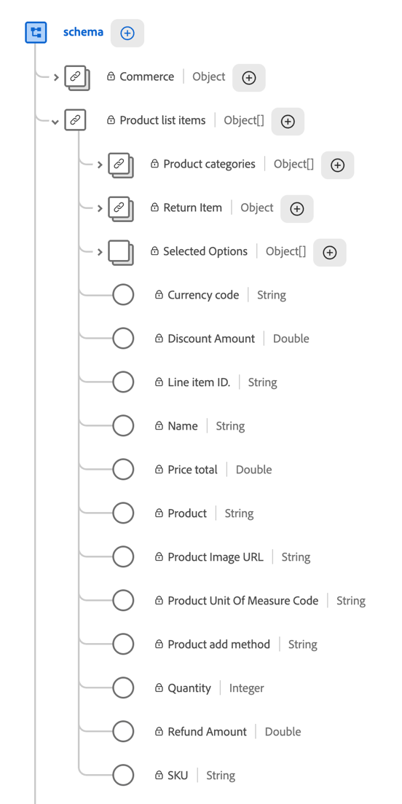

# Componentes de subevento en fuentes de datos

{{release-limited-testing}}

Los componentes de subevento son dimensiones y métricas basadas en campos dentro de una matriz o asignación en el esquema XDM. Permiten analizar los datos en un nivel más granular que el nivel de evento, como los productos individuales de una compra. Para obtener información acerca del uso de estos datos en segmentos, vea [Subeventos](/help/components/segments/sub-event.md).

Utilice la siguiente información para comprender cómo aparecen los componentes de subevento de los campos de matriz y asignación en las fuentes de datos de Customer Journey Analytics.

## Comprensión de los componentes de subeventos

### Componentes de subevento en el esquema XDM

En el esquema XDM, cada elemento de una matriz (una matriz de cadenas o una matriz de objetos) es un subevento. Cada entrada en un campo de asignación es también un subevento, como se describe en [Asignar campos en las fuentes de datos](#use-map-fields-in-data-feeds). Las dimensiones y métricas basadas en los campos de un subevento son componentes de subevento.

Para ver subeventos dentro del esquema XDM en Adobe Experience Platform, seleccione [!UICONTROL **Esquemas**] y expanda un evento que contenga subeventos.

En el ejemplo siguiente, `Product list items` es una matriz de objetos que contiene varios componentes de subevento.



### Diferencias de subeventos entre Analysis Workspace y las fuentes de datos

Los componentes de subevento se representan de forma diferente entre Analysis Workspace y las fuentes de datos en Customer Journey Analytics.

| Ubicación | Representación de los componentes de subevento |
| --- | --- |
| **Analysis Workspace (en Customer Journey Analytics)** | Se pueden seleccionar como componentes individuales, separados de cualquier jerarquía visible. |
| **Fuentes de datos (en Customer Journey Analytics)** | Se representa como un grupo, con su jerarquía intacta. |

### Diferencias de subeventos entre Adobe Analytics y Customer Journey Analytics

Los datos de subeventos (como varios detalles del producto en un único evento de compra) aparecen de forma diferente en las fuentes de datos de Customer Journey Analytics y en las de Adobe Analytics. La siguiente tabla compara cómo cada producto representa los datos de subeventos.

| Producto | Aspecto de los datos de subeventos en las fuentes de datos | Ejemplo: lista de productos |
| --- | --- | --- |
| **Adobe Analytics** | Se aplana en una cadena delimitada en una sola columna. | Una lista de productos contiene varios productos agrupados en una sola cadena:<p>`Power Tools;Cordless Drill;1;129.99,Power Tools;Drill Battery Pack;2;39.98` <!--screenshot of what this looks like: product lists, list vars. --></p> |
| **Customer Journey Analytics** | Los componentes de subevento conservan la jerarquía definida en el esquema XDM. Cuando se agrupan en la misma columna, muestran su jerarquía relacional a su evento principal y a los subeventos del mismo nivel. | Una lista de productos mantiene su jerarquía que se define en el esquema XDM como una matriz:<p>`[{"category":"Power Tools","product":"Cordless Drill","quantity":1,"revenue":129.99},{"category":"Power Tools","product":"Drill Battery Pack","quantity":2,"revenue":39.98}]` <!--screenshot of what this looks like: product lists, list vars. --></p> |

{style="table-layout:auto"}

### Ejemplo de subevento: productos en un evento de compra

Un cliente compra dos productos en un único pedido: un taladro inalámbrico y dos baterías de taladro. Su implementación envía un único evento de compra que incluye ambos productos en la matriz de objetos `productListItems`:

```json
{
  "eventType": "commerce.purchases",
  "timestamp": "2026-09-16T14:32:07.512Z",
  "commerce": {
    "purchases": { "value": 1 }
  },
  "productListItems": [
    { "SKU": "CD-2000", "name": "Cordless Drill", "quantity": 1, "priceTotal": 129.99 },
    { "SKU": "BP-2000", "name": "Drill Battery Pack", "quantity": 2, "priceTotal": 39.98 }
  ]
}
```

Este evento contiene dos subeventos, uno para cada objeto de la matriz `productListItems`. La siguiente tabla muestra qué campos pertenecen al evento y cuáles a sus subeventos.

| Nivel | Campos | Lo que describen los campos |
| --- | --- | --- |
| **Evento** | `eventType`, `timestamp`, `commerce.purchases.value` | La compra en su conjunto. Cada campo tiene un valor para el evento. La métrica **Pedidos** cuenta `1` para este evento, independientemente de cuántos productos contenga. |
| **Subevento** | `SKU`, `name`, `quantity`, `priceTotal` en cada objeto `productListItems` | Un producto individual en la compra. Cada campo tiene un valor por producto. Por ejemplo, `quantity` es `1` para la perforadora inalámbrica y `2` para el paquete de baterías de perforación. |

{style="table-layout:auto"}

>[!NOTE]
>
>Los subeventos solo incluyen los datos que se envían con el evento. Customer Journey Analytics no reconstruye el contenido del carro de compras de eventos anteriores, como adiciones al carro de compras o cierres de compra. Para que los productos aparezcan como subeventos de un evento de compra, la implementación debe incluirlos en `productListItems` en ese evento de compra.

## Añadir componentes de subevento a una fuente de datos

Cuando se añade un componente de subevento a una fuente de datos, un cuadro de diálogo le solicita que añada los demás componentes del mismo subevento.


Los campos del mismo subevento aparecen en el lienzo como un grupo anidado contraíble en lugar de como un elemento plano.


Este grupo refleja la estructura de datos subyacente.

En la salida de la fuente de datos, todos estos componentes aparecen como una matriz anidada en una sola columna.

Para obtener información sobre cómo agregar componentes, incluidos componentes de subevento, a una fuente de datos, consulte [Crear una fuente de datos](/help/components/exports/cja-data-feeds/create-feed.md).

## Datos de subevento de consulta en la salida de la fuente de datos

Dado que los datos de subevento [&#x200B; aparecen de forma diferente en las fuentes de datos de Customer Journey Analytics](#sub-event-differences-between-adobe-analytics-and-customer-journey-analytics), las consultas que utiliza para ellos difieren de las que utiliza para las fuentes de datos de Adobe Analytics.

Los siguientes ejemplos muestran cómo buscar eventos que incluyen un producto específico. Los ejemplos utilizan la sintaxis de Google BigQuery, donde `UNNEST` expande una matriz en filas. Otros almacenes de datos admiten el mismo enfoque con sus propias funciones de matriz, como `FLATTEN` en Snowflake o `explode` en Databricks.

+++ Consulta de datos de producto en fuentes de datos de Customer Journey Analytics

En las fuentes de datos de Customer Journey Analytics, los mismos dos productos aparecen como una matriz de objetos en la columna `product_list_items`. No se requiere análisis de delimitador:

```json
{
  "row_id": "01K3F2M9-...-4821",
  "timestamp_utc": "2026-09-16T14:32:07.512000Z",
  "product_list_items": [
    { "category": "Power Tools", "product": "Cordless Drill", "quantity": 1, "revenue": 129.99,
      "events": {"event1": 1}, "merchandising": {"eVar10": "DrillBundle"} },
    { "category": "Power Tools", "product": "Drill Battery Pack", "quantity": 2, "revenue": 39.98,
      "events": {"event1": 1}, "merchandising": {"eVar10": "DrillBundle"} }
  ]
}
```

La forma de escribir la consulta depende de si desea una fila por evento o una fila por producto coincidente.

**Devuelve una fila por evento**

Para filtrar eventos sin cambiar el número de filas, utilice una función de matriz como `UNNEST` dentro de una subconsulta `EXISTS`:

```sql
SELECT row_id, timestamp_utc, product_list_items
FROM `project.dataset.cja_data_feed` AS f
WHERE EXISTS (
  SELECT 1
  FROM UNNEST(f.product_list_items) AS item
  WHERE item.product = 'Cordless Drill'
);
```

Esta consulta devuelve una fila para cada evento coincidente, con la matriz `product_list_items` completa intacta, independientemente de la cantidad de productos que coincidan en la matriz.

**Devolver una fila por cada producto coincidente**

Para devolver una fila para cada producto coincidente, mueva la función de matriz a la cláusula `FROM` externa:

```sql
SELECT f.row_id, f.timestamp_utc, item.product, item.quantity, item.revenue
FROM `project.dataset.cja_data_feed` AS f,
     UNNEST(f.product_list_items) AS item
WHERE item.product = 'Cordless Drill';
```

Un evento con más de un producto coincidente aparece como varias filas y las columnas del evento, como `row_id`, se repiten en cada fila. Utilice este método solo cuando necesite detalles de nivel de producto. Para contar eventos en los resultados, use `COUNT(DISTINCT row_id)` en lugar de contar filas.

Este método se aplica a cualquier campo de matriz del esquema XDM, no solo a los productos.

+++

+++ Consulta de datos de producto en fuentes de datos de Adobe Analytics

En las fuentes de datos de Adobe Analytics, un evento con dos productos comprados juntos aparece como una sola cadena delimitada en la columna `product_list`:

```text
Power Tools;Cordless Drill;1;129.99;event1=1;eVar10=DrillBundle,Power Tools;Drill Battery Pack;2;39.98;event1=1;eVar10=DrillBundle
```

Para buscar eventos que incluyan un taladro inalámbrico, analice esta cadena con una expresión regular:

```sql
SELECT hitid_high, hitid_low, post_evar10
FROM aa_hit_data
WHERE REGEXP_CONTAINS(product_list, r'(^|,)[^;]*;Cordless Drill;')
```

+++

## Uso de campos de asignación en fuentes de datos

Los campos de asignación del esquema XDM almacenan pares clave-valor. Las fuentes de datos exportan cada asignación como una matriz de objetos, del mismo modo que otros [datos de subevento](#query-sub-event-data-in-data-feed-output). Cada objeto contiene la clave de asignación y su valor como campos independientes.

Los nombres de campo en la salida provienen de los ID de componente que configuró para la fuente de datos, no de nombres fijos como `key` o `value`. Los ejemplos de esta sección utilizan ID de componentes de ejemplo.

<!-- Confirm with Nate before publishing: how the outer array column is named in the output (for example, `survey_responses`). -->

### Mapas simples

Las asignaciones simples son el tipo de asignación que puede crear en su propio esquema. Cada clave es una cadena y cada valor es una cadena o un número entero.

Por ejemplo, un mapa de encuesta almacena cada pregunta como una clave y la respuesta como un valor:

```json
{
  "_yourtenant": {
    "surveyResponses": {
      "How did you hear about us?": "Search engine",
      "How likely are you to recommend us?": 9
    }
  }
}
```

En la salida de la fuente de datos, `survey_question` y `survey_answer` son los identificadores de componente para la clave y el valor:

```json
{
  "survey_responses": [
    { "survey_question": "How did you hear about us?", "survey_answer": "Search engine" },
    { "survey_question": "How likely are you to recommend us?", "survey_answer": 9 }
  ]
}
```

### Mapa de identidad

Cada identidad del campo [`identityMap`](https://experienceleague.adobe.com/es/docs/experience-platform/xdm/field-groups/profile/identitymap) se exporta como un objeto. El objeto contiene el área de nombres de identidad (la clave), junto con el identificador, el estado autenticado y el indicador principal. El área de nombres se repite para cada identidad de dicha área de nombres.

Solo se exportan los atributos del mapa de identidad que existen como dimensiones en la vista de datos y que agrega a la fuente de datos.

```json
{
  "identity_map": [
    { "identity_namespace": "ECID", "identity_id": "83290187457380573620940587193016478103", "authenticated_state": "ambiguous", "is_primary": true },
    { "identity_namespace": "CRMID", "identity_id": "C-1048576", "authenticated_state": "authenticated", "is_primary": false }
  ]
}
```

### Mapas anidados

Algunos campos definidos por Adobe, como `segmentMembership`, son mapas de mapas. Las fuentes de datos se acoplan en una sola matriz, con la clave de primer nivel y la clave de segundo nivel como campos independientes en cada objeto. La clave de primer nivel se repite en cada objeto al que se aplica, por lo que no se pierden datos ni relaciones.

Por ejemplo, `segment_namespace` y `segment_id` son los identificadores de componente de la clave de primer nivel y de la clave de segundo nivel:

```json
{
  "segment_membership": [
    { "segment_namespace": "ups", "segment_id": "04a81716-43d6-4e7a-a49c-f1d8b3129ba9", "status": "realized" },
    { "segment_namespace": "ups", "segment_id": "53cba6b2-a23b-454a-8069-fc41308f1c0f", "status": "exited" }
  ]
}
```


