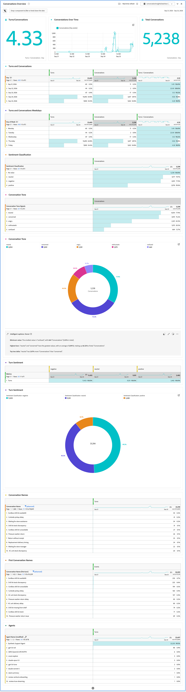

# Analizar perspectivas de conversación

Para analizar Perspectivas de conversación, cree o edite un proyecto en Analysis Workspace y utilice una de las vistas de datos configuradas como vista de datos para uno o varios paneles del proyecto.

## Análisis sencillo

Para crear tablas improvisadas o visualizaciones, usa las métricas de conversación (**[!UICONTROL Turns]**, **[!UICONTROL Conversations]**, **[!UICONTROL Opinión]**, **[!UICONTROL Conversation Tone]** y más) para mostrar una descripción general de las conversaciones.

+++ Proyecto de ejemplo

{zoomable="yes"}

+++

## Análisis detallado

Para realizar un análisis detallado de las conversaciones, use las visualizaciones [Temas de tendencia](/help/analysis-workspace/visualizations/conversation-insights/trending-topics.md), [Resúmenes de conversación](/help/analysis-workspace/visualizations/conversation-insights/conversation-summaries.md) y [Revisión de conversación](/help/analysis-workspace/visualizations/conversation-insights/conversation-review.md). Estas visualizaciones proporcionan diferentes perspectivas sobre los datos de conversación.

+++ Proyecto de ejemplo

{zoomable="yes"}

+++

## Análisis de conversaciones a escala y en contexto

Para analizar conversaciones a escala y proporcionar contexto para estas conversaciones dentro del recorrido completo del cliente:

* Combine los eventos de Perspectivas de conversación con otros conjuntos de datos de evento y conjuntos de datos de búsqueda y perfil adicionales. Agregue estos conjuntos de datos a la conexión seleccionada para la configuración de Perspectivas de conversación.
* Agregue componentes adicionales (métricas y dimensiones) a las vistas de datos que seleccionó para la configuración de Perspectivas de conversación.

+++ Proyecto de ejemplo

Pendiente.

+++ 
