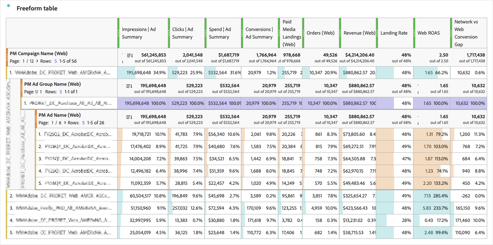

# Unir datos de medios de pago con datos web

Esta guía de caso de uso ilustra cómo puede unir datos de resumen de medios de pago con datos de evento de comportamiento del sitio web en [!DNL Adobe Customer Journey Analytics].


La conexión de sus cuentas de publicidad (Meta, Google Ads y otras) a Experience Platform proporciona datos de resumen de medios de pago en Customer Journey Analytics: impresiones diarias, clics, gastos y conversiones informadas por la red de publicidad por cuenta, campaña, grupo de publicidad, publicidad, experiencia y recurso. Con Customer Journey Analytics, puede recopilar sus propios datos de eventos de comportamiento en el sitio con Web SDK: vistas de página, pedidos, ingresos.

Al unir los dos tipos de datos en una sola tabla de forma libre de Workspace, puede comparar el rendimiento de la publicidad con la actividad en su sitio web. Utilice campañas compartidas, grupos de anuncios e ID de anuncios para informar sobre impresiones, clics y gastos junto con aterrizajes de pago, pedidos e ingresos en [!DNL Analysis Workspace].

| Fuente de datos | Métricas de ejemplo |
|---|---|
| Datos de resumen de medios de pago | Impresiones, clics, gastos, conversiones y valores de conversión recogidos en los informes de la red de anuncios. |
| Eventos de comportamiento del sitio web | Páginas de aterrizaje de pago, vistas de página, pedidos e ingresos medidos en el sitio web |
| Métricas calculadas | Tasa de página de aterrizaje, tasa de conversión web, retorno web de la inversión en publicidad, coste por pedido web y brecha de conversión de red a web |

La combinación de estos dos tipos de datos le permite comparar los datos anteriores al clic (de sus anuncios) y posteriores al clic (de su sitio web).

Esta guía cubre los escenarios basados en las conexiones administradas por las configuraciones de [!DNL Adobe Content Analytics] y las conexiones que usted configuró.

## Funcionamiento

El diagrama siguiente ilustra cómo se incorporan los datos de resumen de medios de pago y los datos de evento de comportamiento del sitio web a través de una conexión de Customer Journey Analytics.

La vista de datos es responsable de analizar y alinear los datos, por lo que puede utilizar Workspace para informar correctamente sobre los datos.

{zoomable="yes"}

Los conjuntos de datos de resumen de medios de pago contienen métricas diarias sin un ID de persona. Los conjuntos de datos de evento del sitio web contienen eventos de comportamiento con marca de tiempo y un identificador de persona. Un grupo de datos de resumen asocia dimensiones de estos conjuntos de datos para que aparezcan valores de dimensión iguales en la misma fila de informes.

>[!IMPORTANT]
>
>Este vínculo alinea los datos de resumen agregados y los eventos web para el sistema de informes. No vincula una impresión de anuncio o un clic con una persona individual. Las conversiones a través de redes de anuncios conservan la metodología de creación de informes de la red. Los pedidos e ingresos del sitio web utilizan la configuración de atribución que configura en esta guía.

## Comprensión de la unión a informes

Solo puede unirse a niveles cuyos ID aparezcan en las direcciones URL de la página de aterrizaje o en campos de eventos existentes. Por ejemplo, el etiquetado solo de campaña admite la creación de informes de campaña, pero no de nivel de anuncio. Las uniones de nivel de experiencia y de nivel de recurso requieren parámetros de URL adicionales y están fuera del ámbito de esta guía.

Consulte [Datos de resumen](https://experienceleague.adobe.com/en/docs/analytics-platform/using/cja-dataviews/summary-data) y [Configuración del componente de grupo de datos de resumen](https://experienceleague.adobe.com/en/docs/analytics-platform/using/cja-dataviews/component-settings/summary-data-group) para obtener una referencia.

### Elija la clave de unión

Los conjuntos de datos de medios de pago proporcionan ID de red sin procesar e identificadores únicos globales (GUID) generados por Adobe.

| Identificador | Ejemplo | Finalidad |
|---|---|---|
| ID de red | ID de campaña `123456789` | Hacer coincidir un ID capturado desde una dirección URL de una página de aterrizaje con una dimensión de resumen de medios de pago |
| GUID | `meta_111111111_123456789` | Identificar una entidad de medios de pago mediante la jerarquía de red, cuenta y entidad |

La estructura GUID es `{adNetwork}_{accountID}[_{campaignID}[_{adGroupID}[_{adID}]]]`. Los componentes de medios de pago administrados por [!DNL Adobe Content Analytics] utilizan estas GUID.

Esta guía utiliza los identificadores de red para las uniones web porque las macros de campaña, grupo de anuncios y URL de anuncios no proporcionan toda la información necesaria para reconstruir un GUID. Utilice estos campos de resumen:

| Nivel de informes | Campo de ID de red | Campo GUID |
|---|---|---|
| Campaign | `paidMedia.campaignID` | `paidMedia.campaignGUID` |
| Grupo de publicidad | `paidMedia.adGroupID` | `paidMedia.adGroupGUID` |
| Publicidad | `paidMedia.adID` | `paidMedia.adGUID` |

El campo de red es `paidMedia.adNetwork`. Los valores de ejemplo incluyen `meta` y `google_ads`. Las salidas de campo derivadas deben coincidir exactamente con los valores de los conjuntos de datos.

>[!NOTE]
>
>Un grupo de datos de resumen coincide con los valores de dimensión, no con una combinación de todas las dimensiones de la tabla. Confirme que los ID seleccionados identifican las entidades de forma inequívoca en las cuentas y redes sobre las que realiza informes. Los grupos basados en nombres pueden combinar entidades distintas que compartan un nombre.

## Requisitos previos

Confirme que dispone de:

* [!DNL Customer Journey Analytics] Select o superior, con acceso a las funciones de campo derivadas usadas aquí: [Análisis de URL](/help/data-views/derived-fields/derived-fields.md#url-parse), [Case When](/help/data-views/derived-fields/derived-fields.md#case-when), [Reemplazo de Regex](/help/data-views/derived-fields/derived-fields.md#regex-replace) y, para el enriquecimiento de nombres, [Lookup](/help/data-views/derived-fields/derived-fields.md#lookup).
* [!DNL Adobe Experience Platform] permisos para administrar esquemas, conjuntos de datos y flujos de datos en la zona protegida de destino, y acceso a conjuntos de datos y al servicio de consulta para la verificación.
* Permiso de [!DNL Customer Journey Analytics] para editar la conexión de destino y la vista de datos.
* Conectores de fuente de medios de pago configurados en la misma zona protegida e ingiriendo conjuntos de datos de resumen y búsqueda. Para ver un ejemplo de conector, consulte [Origen de Meta Ads](https://experienceleague.adobe.com/en/docs/experience-platform/sources/connectors/advertising/meta-ads).
* Eventos de sitio web que capturan la dirección URL de la página de aterrizaje completa, incluida su cadena de consulta, o campos equivalentes que contienen los ID de red.


### Etiquetado de anuncios

Identifique los parámetros de consulta que contienen su campaña, grupo de publicidad e ID de publicidad. El etiquetado basado en ID existente se puede utilizar sin cambios en las plataformas de publicidad.

| Patrón de etiquetado | Parámetro de campaña | Parámetro de grupo de anuncios | Parámetro de anuncio |
|---|---|---|---|
| Meta ID en la dirección URL del sitio web | <code>campaign_id={{campaign.id}}</code> | <code>adset_id={{adset.id}}</code> | <code>ad_id={{ad.id}}</code> |
| ID de Meta en parámetros de UTM | <code>utm_campaign={{campaign.id}}</code> | <code>utm_term={{adset.id}}</code> | <code>utm_content={{ad.id}}</code> |
| ID de Google Ads en parámetros de UTM | <code>utm_campaign={campaignid}</code> | <code>utm_term={adgroupid}</code> | <code>utm_content={creative}</code> |

Para el etiquetado de Meta UTM, un valor de origen como `utm_source=fb` puede identificar la red. Para el etiquetado UTM de Google Ads, use un valor de origen como `utm_source=google`.

Algunas integraciones de [!DNL Adobe Advertising] utilizan un valor `s_kwcid` con este diseño:

```text
AL!<id>!3!{creative}!{matchtype}!{placement}!{network}!{product_partition_id}!{keyword}!{campaignid}!{adgroupid}
```

Las reglas de análisis que aparecen más adelante en esta guía se aplican únicamente a este diseño. Inspeccione las direcciones URL de aterrizaje reales antes de utilizarlas.

Si no tiene acceso a las plataformas de publicidad, inspeccione las direcciones URL de aterrizaje en el conjunto de datos web. También puede inspeccionar estos campos de búsqueda de medios de pago:

* Búsqueda de cuenta de Google Ads: `additionalDetails` entradas con los nombres `google_ads_tracking_url_template` y `google_ads_final_url_suffix`.
* Búsqueda de anuncios de Meta: `paidMedia.adDetails.creative.paidMediaCreative.destinationURL`.

Las macros de las direcciones URL de destino almacenadas pueden tener codificación porcentual. Valide los ID expandidos en eventos de sitio web reales, en lugar de suponer que una URL almacenada representa la URL de aterrizaje final.

>[!IMPORTANT]
>
>Los nombres de las campañas, como `utm_campaign=fall_sale`, no coinciden con los identificadores de campaña. Únase solo a niveles que contengan ID reales. Si faltan ID, trabaje con su equipo de operaciones de publicidad para actualizar el etiquetado para el tráfico futuro; esta configuración no puede reconstruir los ID que faltan para las visitas históricas.

### Punto de partida

Abra la vista de datos que desee utilizar e inspeccione los componentes para determinar el punto de partida.

| | Punto de partida | Configuración existente | Pasos a seguir |
|---|---|---|---|
| A | Content Analytics con medios web o móviles y de pago | Conjuntos de datos y componentes de medios de pago, además de conjuntos de datos de búsqueda y eventos de Content Analytics | Agregue el conjunto de datos de evento del sitio web si es necesario y, a continuación, configure los campos derivados de la web y los grupos de informes |
| B | Content Analytics solo con medios de pago | Conjuntos de datos y componentes de medios de pago; también pueden estar presentes los conjuntos de datos de búsqueda de contenido compartido | Agregue el conjunto de datos de evento del sitio web y, a continuación, configure los campos derivados de la web y los grupos de informes |
| C | Medios de pago sin aprovisionamiento de Content Analytics | Los conjuntos de datos de medios de pago existen en Experience Platform, pero la conexión y la vista de datos no contienen la configuración de medios de pago | Añada el sitio web y los conjuntos de datos de medios de pago y, a continuación, cree los medios de pago y los componentes web |
| D | Content Analytics sin medios de pago | Solo componentes de Content Analytics | Habilite el canal de medios de pago en la configuración de Content Analytics y, a continuación, siga la ruta de configuración de pago existente |

No elimine ni modifique conjuntos de datos aprovisionados por el sistema ni componentes de solo lectura al ampliar una conexión que administra Content Analytics.

## Recopilar eventos de comportamiento del sitio web

Omita la creación de esquemas, conjuntos de datos y flujos de datos si el sitio web ya envía los eventos necesarios a un conjunto de datos utilizado en Customer Journey Analytics. Confirme que `web.webPageDetails.URL` incluye la cadena de consulta de la página de aterrizaje.

### Creación del esquema y el conjunto de datos

1. En Experience Platform, seleccione la zona protegida de destino.
1. Vaya a **[!UICONTROL Administración de datos]** > **[!UICONTROL Esquemas]** y, a continuación, seleccione **[!UICONTROL Crear esquema]**.
1. Elija **[!UICONTROL Manual]** y la clase `XDM ExperienceEvent`.
1. Asigne un nombre al esquema, por ejemplo `Web Behavioral Events`.
1. Añada los grupos de campos necesarios para la implementación.

   | Grupo de campos | Datos necesarios |
   |---|---|
   | ExperienceEvent de AEP Web SDK | Dirección URL de la página, vistas de página, referente y otro contexto web |
   | Detalles de Commerce | Recuento de compras, valor de pedidos, moneda, ID de compra y detalles del producto |
   | Detalles de marketing de campaña, opcional | Códigos de seguimiento si su implementación los captura por separado |
   | IdentityMap, si no está presente | El identificador de la persona, como ECID |

1. Guarde el esquema. La activación del perfil no es necesaria para este caso de uso de creación de informes.
1. Vaya a **[!UICONTROL Administración de datos]** > **[!UICONTROL Conjuntos de datos]** > **[!UICONTROL Crear conjunto de datos]** > **[!UICONTROL Crear conjunto de datos a partir del esquema]**.
1. Seleccione el esquema y cree un conjunto de datos denominado, por ejemplo, `Web Behavioral Events`. Deje **[!UICONTROL Perfil]** deshabilitado a menos que otro caso de uso lo requiera.

### Configuración de la secuencia de datos y Web SDK

1. Vaya a **[!UICONTROL Recopilación de datos]** > **[!UICONTROL Flujos de datos]** > **[!UICONTROL Nuevo flujo de datos]**.
1. Asigne un nombre al conjunto de datos y seleccione el esquema de evento como esquema de asignación.
1. Guarde, luego seleccione **[!UICONTROL Agregar servicio]** > **[!UICONTROL Adobe Experience Platform]**.
1. Seleccione la zona protegida y el conjunto de datos de evento y, a continuación, **[!UICONTROL Guardar]**.
1. Use la ID de flujo de datos para configurar [Experience Platform Web SDK](https://experienceleague.adobe.com/en/docs/experience-platform/collection/js/js-overview).

Capture lo siguiente:

* Capturar una vista de página en cada página, con la dirección URL completa en `web.webPageDetails.URL` y `web.webPageDetails.pageViews.value` establecida en `1`.
* Eventos Purchase con `commerce.purchases.value` establecido en `1`, además de `commerce.order.priceTotal`, `commerce.order.currencyCode` y `commerce.order.purchaseID`.
* Un identificador de persona adecuado para su conexión de Customer Journey Analytics.

No es necesario analizar los parámetros de UTM en el código del sitio web. Los campos derivados de esta guía analizan las direcciones URL en el momento del informe. Si su implementación ya captura los ID en campos dedicados, utilice esos campos en su lugar.

### Verificar ingesta

Compruebe que la actividad del conjunto de datos se haya ingerido correctamente. En el servicio de consultas, ejecute la siguiente consulta y reemplace `web_behavioral_events` por el nombre de tabla SQL del conjunto de datos:

```sql
SELECT timestamp, eventType, web.webPageDetails.URL
FROM web_behavioral_events
WHERE web.webPageDetails.URL RLIKE '[?&](campaign_id|utm_campaign|s_kwcid)='
ORDER BY timestamp DESC
LIMIT 20;
```

Confirme que las direcciones URL devueltas contienen ID de red expandidos. Si existe tráfico de pago pero la consulta no devuelve filas, inspeccione las direcciones URL de aterrizaje recientes y adapte el patrón de parámetros al etiquetado.

## Configuración de la conexión

Para introducir el conjunto de datos de evento web en Customer Journey Analytics, debe añadir el conjunto de datos a la conexión correspondiente. Esto garantiza que los eventos de comportamiento web estén disponibles junto con los conjuntos de datos de medios de pago para su análisis.

### Añadir el conjunto de datos de evento del sitio web

1. En Customer Journey Analytics, vaya a **[!UICONTROL Administración de datos]** > **[!UICONTROL Conexiones]**.
1. Edite la conexión que contiene los conjuntos de datos de medios de pago.
1. Seleccione **[!UICONTROL Agregar conjuntos de datos]** y elija el conjunto de datos de evento del sitio web.
1. Configure el conjunto de datos:

   | Configuración | Valor |
   |---|---|
   | ID de persona | `identityMap` con el área de nombres de ECID o el campo de ID de persona de su implementación |
   | Marca de tiempo | `timestamp` |
   | Tipo de fuente de datos | Datos web |
   | Importar todos los datos nuevos | Habilitado |
   | Relleno de los datos existentes | Habilitado para el período histórico que necesite |

1. Agregue el conjunto de datos y guarde la conexión.

### Agregar conjuntos de datos de medios de pago si no están configurados

>[!IMPORTANT]
>
>Omita esta sección para conexiones en las que Content Analytics administra conjuntos de datos de medios de pago.


Agregue al menos el resumen de anuncios de medios de pago y los conjuntos de datos Cuenta de medios de pago, Campaña de medios de pago, Grupo de anuncios de medios de pago y Búsqueda de anuncios de medios de pago.

| Conjunto de datos | Tipo | Configuración de clave |
|---|---|---|
| Resumen de anuncios de medios pagados | Resumen | Utilice la configuración de marca de hora diaria del esquema; habilite la importación de nuevos datos y el relleno requerido. |
| Búsqueda de cuenta de medios de pago | Búsqueda | Clave: `paidMedia.accountGUID`; campo coincidente en el resumen de publicidad: `paidMedia.accountGUID`. |
| Búsqueda de campañas de medios pagados | Búsqueda | Clave: `paidMedia.campaignGUID`; campo coincidente en el resumen de publicidad: `paidMedia.campaignGUID`. |
| Búsqueda de grupos de publicidad de medios de pago | Búsqueda | Clave: `paidMedia.adGroupGUID`; campo coincidente en el resumen de publicidad: `paidMedia.adGroupGUID`. |
| Búsqueda de anuncios de medios pagados | Búsqueda | Clave: `paidMedia.adGUID`; campo coincidente en el resumen de publicidad: `paidMedia.adGUID`. |

Confirme que el editor de conexiones expone los campos coincidentes deseados antes de guardar. El enriquecimiento de nombres que se muestra más adelante en esta guía utiliza reglas de búsqueda de campos derivados explícitamente.

Agregue otros conjuntos de datos de resumen disponibles solo cuando necesite sus desgloses, como geografía, demografía, ubicación o rendimiento.

## Configuración de la vista de datos

Abra **[!UICONTROL Administración de datos]** > **[!UICONTROL Vistas de datos]** y seleccione la vista de datos. Si es necesario, cree una vista de datos con la conexión configurada.

Para una nueva vista de datos, utilice GMT para alinear los eventos del sitio web con los días de medios pagados UTC y mantenga el tiempo de espera de sesión predeterminado de 30 minutos a menos que difieran los requisitos de informes. Cambiar la zona horaria de una vista de datos existente afecta a sus otros informes; evalúe ese impacto antes de cambiarlo.

### Agregar métricas de medios de pago si no está configurado

Omita este paso si estas métricas o dimensiones ya existen. Agregue los campos siguientes de **[!UICONTROL Resumen de anuncios de medios de pago]**:

| Nombre del componente | Campo de esquema | Formato |
|---|---|---|
| **Métricas** | | |
| Impresiones \| Resumen de publicidad | `paidMedia.metrics.impressions` | Decimal |
| Clics \| Resumen de publicidad | `paidMedia.metrics.clicks` | Decimal |
| Gasto \| Resumen de publicidad | `paidMedia.metrics.spend` | Moneda |
| Conversiones \| Resumen de publicidad | `paidMedia.metrics.conversions` | Decimal |
| Valor de conversión \| Resumen de publicidad | `paidMedia.metrics.conversionValue` | Moneda |
| **Dimensiones** | | |
| Red de anuncios | `paidMedia.adNetwork` | Cadena |
| GUID de cuenta | `paidMedia.accountGUID` | Cadena |
| GUID de la campaña | `paidMedia.campaignGUID` | Cadena |
| GUID del AdGroup | `paidMedia.adGroupGUID` | Cadena |
| GUID de anuncio | `paidMedia.adGUID` | Cadena |

El formato de moneda no concilia las distintas monedas de origen. Confirme la base de moneda antes de comparar gastos e ingresos.

Utilice campos derivados para crear nombres descriptivos para la dimensión GUID. Use una regla [Lookup](/help/data-views/derived-fields/derived-fields.md#lookup) para aplicar un nombre descriptivo a la dimensión GUIDs.  Por ejemplo: busque **[!UICONTROL paidMedia.accountGUID (Resumen de anuncios de medios de pago)]** usando el conjunto de datos de búsqueda **[!UICONTROL Búsqueda de cuentas de medios de pago]** con clave coincidente `paidMedia.accountGUID` y valor que se va a devolver: `paidMedia.accountDetails.accountName`.


### Crear el campo derivado de la red web

Seleccione **[!UICONTROL Crear campo derivado]** y asigne un nombre al campo `PM Network (Web)`. Todas las reglas del [análisis de URL](/help/data-views/derived-fields/derived-fields.md#url-parse) a continuación leen el campo `web.webPageDetails.URL` del conjunto de datos del sitio web, al que se hace referencia aquí como URL de página.

Agregar reglas en este orden:

| Regla | Función | Configuración |
|---|---|---|
| 1 | [Análisis de URL](/help/data-views/derived-fields/derived-fields.md#url-parse) | URL de página. Obtener valor de cadena de consulta para `utm_source`. |
| 2 | [Análisis de URL](/help/data-views/derived-fields/derived-fields.md#url-parse) | URL de página. Obtener valor de cadena de consulta para `s_kwcid`. |
| 3 | [Análisis de URL](/help/data-views/derived-fields/derived-fields.md#url-parse) | URL de página. Obtener valor de cadena de consulta para `gclid`. |
| 4 | [Análisis de URL](/help/data-views/derived-fields/derived-fields.md#url-parse) | URL de página. Obtener valor de cadena de consulta para `fbclid`. |
| 5 | [Caso Cuándo](/help/data-views/derived-fields/derived-fields.md#case-when) | Aplique las condiciones siguientes. |

Configure la regla final [Case When](/help/data-views/derived-fields/derived-fields.md#case-when):

1. Si se establece la regla 2 o la regla 3, devuelve `google_ads`.
1. De lo contrario, si la regla 4 está establecida o la regla 1 es igual a `fb`, `facebook`, `ig`, `instagram` o `meta`, devuelve `meta`.
1. De lo contrario, si la regla 1 es igual a `google`, devuelve `google_ads`.
1. Agregue asignaciones para otras redes solo después de confirmar sus valores en `paidMedia.adNetwork`.
1. De lo contrario, no devuelve ningún valor.

Para escribir un resultado fijo, abra el selector de valores, seleccione **[!UICONTROL Valor de cadena personalizado]** e introduzca la cadena.

Estas reglas de clasificación se basan en el etiquetado, no en la prueba de que una visita provenga de un anuncio de pago. Por ejemplo, un parámetro de origen solo también puede aparecer en vínculos no pagados. Adapte las condiciones a las convenciones de etiquetado antes de utilizar el campo como clasificador de tráfico de pago.

### Creación de los campos derivados del ID web

Cree un campo derivado por nivel de informe. La siguiente estructura administra los tres patrones de etiquetado descritos anteriormente:

| Regla | Función | Configuración |
|---|---|---|
| 1 | [Análisis de URL](/help/data-views/derived-fields/derived-fields.md#url-parse) | Lea el parámetro Meta específico del nivel desde la URL de la página |
| 2 | [Análisis de URL](/help/data-views/derived-fields/derived-fields.md#url-parse) | Lea el parámetro de UTM específico del nivel en la URL de la página. |
| 3 | [Análisis de URL](/help/data-views/derived-fields/derived-fields.md#url-parse) | Leer `s_kwcid` de la dirección URL de la página |
| 4 | [Reemplazar regex](/help/data-views/derived-fields/derived-fields.md#regex-replace) | Aplicar la expresión específica del nivel a la regla 3; salida `$1` |
| 5 | [Caso Cuándo](/help/data-views/derived-fields/derived-fields.md#case-when) | Si se define la regla 3, devolver la regla 4; de lo contrario, si se define la regla 1, devolver la regla 1; de lo contrario, devolver la regla 2 |

Utilice los siguientes valores:

| Campo derivado | Parámetro de Meta | Parámetro de UTM | Expresión regex |
|---|---|---|---|
| **ID de campaña de la tarde (web)** | `campaign_id` | `utm_campaign` | `^.*!([^!]*)![^!]*$` |
| **ID. de grupo de publicidad de la tarde (web)** | `adset_id` | `utm_term` | `^.*!([^!]*)$` |
| **ID de anuncio de la tarde (web)** | `ad_id` | `utm_content` | `^[^!]*![^!]*![^!]*!([^!]*)!.*$` |

En la regla [Case When](/help/data-views/derived-fields/derived-fields.md#case-when) final, seleccione los resultados de reglas anteriores del selector de valores en lugar de introducirlos como cadenas literales.

La expresión de campaña extrae el último valor `s_kwcid`, la expresión del grupo de publicidad extrae el último valor y la expresión de publicidad extrae el cuarto valor. Estas posiciones dependen del diseño exacto que se mostró anteriormente.

Use **[!UICONTROL Resultado final]** para confirmar que los resultados coinciden con los ID en el resumen de anuncios de medios de pago. No conserve una rama de análisis `s_kwcid` si las direcciones URL utilizan un diseño diferente. Si las direcciones URL solo utilizan parámetros de UTM, omita las reglas que no utilice y actualice en consecuencia las referencias de reglas posteriores.

Cada campo derivado admite hasta cinco [reglas de análisis de URL](/help/data-views/derived-fields/derived-fields.md#url-parse) y una [regla de reemplazo de regex](/help/data-views/derived-fields/derived-fields.md#regex-replace). Mantener un ID por campo derivado.

### Crear la métrica de aterrizajes pagados

Cree un campo derivado denominado `Paid Media Landings (Web)` con `PM Campaign ID (Web)` como entrada.

El generador expande las reglas del campo de entrada al nuevo campo. Después de esas reglas, agregue una regla [Case When](/help/data-views/derived-fields/derived-fields.md#case-when) que devuelva el valor numérico personalizado `1` cuando se establezca el resultado del ID de campaña, y ningún valor en caso contrario. Añada el resultado como métrica.

Esta métrica cuenta los eventos que llevan un ID de campaña. Esta métrica representa los aterrizajes únicamente cuando la implementación envía esa URL con ID en el evento de aterrizaje en lugar de en eventos repetidos o no relacionados.

>[!NOTE]
>
>Las reglas de campo derivadas expandidas son copias. Si cambia un campo de ID, inspeccione y actualice también los campos de aterrizaje y nombre correspondientes. Si ha omitido las reglas de análisis, haga referencia a la regla de ID final real en lugar de suponer que es la regla 5.

### Agregar campos de nombre web opcionales

Para informar por nombre, cree los siguientes campos derivados con una [regla de búsqueda](/help/data-views/derived-fields/derived-fields.md#lookup) después de las reglas de ID web expandidas:

| Campo derivado | Entrada | Buscar un conjunto de datos | Campo coincidente | Campo de retorno |
|---|---|---|---|---|
| Nombre de campaña de PM (web) | Salida final del ID de campaña de PM (web) | Búsqueda de campañas de medios pagados | `paidMedia.campaignID` | `paidMedia.metadata.name` |
| Nombre del grupo de publicidad de PM (Web) | Salida final del ID del grupo de publicidad de PM (web) | Búsqueda de grupos de publicidad de medios de pago | `paidMedia.adGroupID` | `paidMedia.metadata.name` |
| Nombre del anuncio de PM (web) | Salida final del ID de anuncio de PM (web) | Búsqueda de anuncios de medios pagados | `paidMedia.adID` | `paidMedia.metadata.name` |

Seleccione la regla de ID final como campo al que aplicar la búsqueda. Compruebe los nombres en la previsualización de salida final antes de añadir los campos como dimensiones. Si el campo coincidente requerido no está disponible, utilice en su lugar informes basados en ID.

Los nombres coinciden como texto. Utilice dimensiones de ID cuando diferentes entidades compartan un nombre.

### Añadir componentes web y configurar la atribución

Agregue el ID web y los campos derivados de la red como dimensiones. Agregue los campos de nombre opcionales si los ha creado. Mantenga la configuración de los componentes en sus valores predeterminados para que coincida con las dimensiones de resumen que agregue a sus grupos.

Confirme que la vista de datos incluye los componentes web que necesita:

| Componente | Tipo | Campo de esquema |
|---|---|---|
| URL de la página | Dimensión | `web.webPageDetails.URL` |
| Nombre de página | Dimensión | `web.webPageDetails.name` |
| URL de referente | Dimensión | `web.webReferrer.URL` |
| Tipo de evento | Dimensión | `eventType` |
| SKU de producto | Dimensión | `productListItems.SKU` |
| Nombre del producto | Dimensión | `productListItems.name` |
| Vistas de página | Métrica | `web.webPageDetails.pageViews.value` |
| Añadir a los carros | Métrica | `commerce.productListAdds.value` |
| Pedidos | Métrica | `commerce.purchases.value` |
| Ingresos | Métrica | `commerce.order.priceTotal` |

Agregue el campo derivado aterrizajes de pago como métrica y, a continuación, configure métricas de pedidos e ingresos independientes:

1. Duplique **[!UICONTROL Orders]** y asigne un nombre a la copia `Orders (Web)`. Si **[!UICONTROL Pedidos]** no existen, agregue `commerce.purchases.value` directamente.
1. Duplicar **[!UICONTROL Ingresos]** y nombrar la copia `Revenue (Web)`. Si **[!UICONTROL Ingresos]** no existen, agregue `commerce.order.priceTotal` directamente.
1. Formatee **[!UICONTROL Pedidos (Web)]** como decimal con cero decimales y **[!UICONTROL Ingresos (Web)]** como moneda.
1. Para ambas métricas, abra **[!UICONTROL Atribución]** y habilite **[!UICONTROL Anular atribución predeterminada]**.
1. Seleccione el modelo **[!UICONTROL último contacto]** y el contenedor **[!UICONTROL sesión]**.

Mantenga las métricas originales de **[!UICONTROL Pedidos]** e **[!UICONTROL Ingresos]** sin cambios para conservar los informes existentes. Se requiere habilitar explícitamente la anulación para esta configuración, incluso cuando los valores predeterminados mostrados parecen coincidir.

Para obtener crédito de conversión en las visitas que regresan, considera un contenedor de **[!UICONTROL Persona]** y una ventana retrospectiva adecuada en su lugar. Consulte el [caso de uso de datos de resumen](https://experienceleague.adobe.com/en/docs/analytics-platform/using/cja-usecases/data-views/summary-data).

Utilice la atribución de métricas en lugar de añadir persistencia a las dimensiones de ID web. Para evitar inflar los recuentos interpretados como aterrizajes, no conserve los ID en eventos posteriores, ya que esto cambia qué eventos aparecen en las filas de la campaña.

### Creación de dimensiones de unión del lado del resumen

Añada dimensiones independientes del Resumen de anuncios de medios de pago para las uniones web:

| Nombre del componente | Campo de esquema |
|---|---|
| Red de anuncios (unidos) | `paidMedia.adNetwork` |
| ID de campaña (red) | `paidMedia.campaignID` |
| ID de grupo de publicidad (red) | `paidMedia.adGroupID` |
| ID de anuncio (red) | `paidMedia.adID` |

No edite ni duplique componentes de medios de pago de solo lectura administrados por plantillas. Cree los componentes independientes anteriores de los campos de esquema.

Si ha creado campos de nombre web opcionales, cree también estos campos derivados de la búsqueda del lado del resumen:

| Nombre del componente | Entrada del resumen de publicidad | Buscar un conjunto de datos | Campo coincidente | Campo de retorno |
|---|---|---|---|---|
| Nombre de campaña (combinada) | `paidMedia.campaignGUID` | Búsqueda de campañas de medios pagados | `paidMedia.campaignGUID` | `paidMedia.metadata.name` |
| Nombre del grupo de publicidad (unido) | `paidMedia.adGroupGUID` | Búsqueda de grupos de publicidad de medios de pago | `paidMedia.adGroupGUID` | `paidMedia.metadata.name` |
| Nombre del anuncio (unido) | `paidMedia.adGUID` | Búsqueda de anuncios de medios pagados | `paidMedia.adGUID` | `paidMedia.metadata.name` |

Utilice un GUID del conjunto de datos de resumen como entrada de cada búsqueda. Una dimensión tomada directamente de un conjunto de datos de consulta no cumple los requisitos para una dimensión de resumen en un grupo de datos de resumen.

### Creación de grupos de datos de resumen

Cree cada grupo en la dimensión web que vaya a utilizar en los informes. Agregue la dimensión de resumen correspondiente y oculte el miembro agregado en la creación de informes.

| Dimensión web: cree el grupo aquí | Dimensión de resumen: agregar como miembro oculto |
|---|---|
| Red PM (Web) | Red de anuncios (unidos) |
| ID de campaña de PM (web) | ID de campaña (red) |
| ID del grupo de publicidad de PM (web) | ID de grupo de publicidad (red) |
| ID de anuncio de PM (web) | ID de anuncio (red) |
| Nombre de campaña de PM (web), opcional | Nombre de campaña (combinada) |
| Nombre del grupo de publicidad de PM (Web), opcional | Nombre del grupo de publicidad (unido) |
| Nombre del anuncio de PM (Web), opcional | Nombre del anuncio (unido) |

Para cada fila:

1. Seleccione la dimensión web.
1. Abra **[!UICONTROL Grupo de datos de resumen]** y habilite **[!UICONTROL Crear agrupación]**.
1. Añada la dimensión Resumen.
1. Habilite **[!UICONTROL Ocultar en creación de informes]** para el miembro de resumen agregado. Mantenga la dimensión web visible.
1. Confirme que la configuración de los componentes, incluidas las minúsculas, las subcadenas y las reglas de inclusión/exclusión, coinciden entre los miembros.

Cada grupo admite hasta 10 dimensiones. Para incluir métricas de otro conjunto de datos de resumen, agregue la dimensión de resumen equivalente de ese conjunto de datos al mismo grupo que un miembro oculto.

>[!IMPORTANT]
>
>Utilice la dimensión web como dimensión de informes y cree el grupo en esa dimensión. La organización inversa puede mostrar métricas de resumen sin las métricas web correspondientes.

Guarde la vista de datos.

### Crear métricas calculadas

En Workspace, vaya a **[!UICONTROL Componentes]** > **[!UICONTROL Métricas calculadas]** y cree las siguientes métricas con la vista de datos configurada:

| Nombre | Definición | Formato |
|---|---|---|
| Tasa de aterrizaje | Aterrizajes en medios de pago (web) / Clics \| Resumen de publicidad | Porcentaje |
| Tasa de conversión web | Pedidos (web) / Desembarques de medios de pago (web) | Porcentaje |
| ROAS web | Ingresos (Web) / Gasto \| Resumen de publicidad | Decimal, dos lugares |
| Coste por pedido web | Gasto \| Resumen de publicidad / Pedidos (Web) | Moneda |
| Separación entre conversión de red y web | Conversiones \| Resumen de anuncio - Pedidos (Web) | Decimal, cero lugares |

Revise las filas con cero denominadores antes de interpretar las métricas de proporción. Un intervalo de conversión entre red y web no indica por sí mismo un error: las dos fuentes pueden diferir en las ventanas de atribución, medición e informes.

## Creación y validación del informe

1. Cree un proyecto de Workspace con la vista de datos configurada.
1. Elija un intervalo de fechas con datos de ambos orígenes. Permiten retrasos en la ingesta de medios pagados; los datos de resumen pueden retrasar los eventos del sitio web un día.
1. Agregue una tabla de forma libre con **[!UICONTROL PM Campaign ID (Web)]** como dimensión de fila o **[!UICONTROL PM Campaign Name (Web)]** si configuró grupos de nombres.
1. Agregar **[!UICONTROL Impresiones | Resumen de publicidad]**, **[!UICONTROL Clics | Resumen de publicidad]**, **[!UICONTROL Gasto | Resumen de anuncios]**, **[!UICONTROL Conversiones | Resumen de anuncios]**, **[!UICONTROL aterrizajes de medios de pago | Resumen de anuncios]**, **[!UICONTROL Pedidos (Web)]**, **[!UICONTROL Ingresos (Web)]** y las métricas calculadas.
1. Desglose una fila de campaña por grupo de anuncios web y dimensiones de publicidad. Confirme que las métricas de resumen y web se rellenan en cada nivel configurado.
1. Agregue una segunda tabla usando **[!UICONTROL PM Network (Web)]** para revisar los totales de nivel de red y la fila sin valor.

   

   

Compruebe lo siguiente antes de compartir el informe:

* Los ID de evento de aterrizaje coinciden con los ID de resumen de anuncios de medios pagados.
* Las métricas de medios de pago y las métricas web se rellenan en las mismas filas.
* Los pedidos e ingresos reciben la sesión o atribución de persona prevista.
* Se entienden las filas sin valor. Pueden contener datos de resumen o actividad web sin coincidencias sin identificadores de medios de pago.
* Las diferencias entre el aterrizaje y el clic son coherentes con la configuración de recopilación, la administración del consentimiento y las ventanas de creación de informes. No hay una tasa de coincidencia esperada universal.

### Solucionar problemas de coincidencia

| Síntoma | Comprobación y acción correctiva |
|---|---|
| Las métricas de resumen se rellenan, pero todas las métricas web son cero | Confirme que las filas utilizan dimensiones web y que los grupos se crearon en esas dimensiones. A continuación, compruebe si las direcciones URL de aterrizaje contienen ID reales en lugar de nombres. |
| Las métricas web se rellenan, pero el nivel de resumen está vacío | Confirme que la dimensión de resumen del nivel se encuentra en el grupo correspondiente y que existen datos de medios de pago coincidentes para las fechas seleccionadas. |
| Faltan nombres en las filas web | Compruebe la entrada de búsqueda y el campo correspondiente en la previsualización de salida final. Utilice grupos de ID si el enriquecimiento de nombres no está disponible. |
| Los ID web contienen macros literales o codificadas | Pida al equipo de operaciones de publicidad que inspeccione la dirección URL de destino y confirme que la red expande las macros antes de aterrizar. |
| Los ID de Google Ads no coinciden | Inspeccione el diseño de `s_kwcid` real o los parámetros de UTM y actualice las reglas de análisis. |
| Los valores de red están divididos, como `facebook` y `meta` | Hacer que la salida del campo derivado de red coincida exactamente con `paidMedia.adNetwork`. |
| Aparece un ID en filas independientes | Confirme que la configuración coincide en todas las dimensiones agrupadas e inspeccione los valores de cadena subyacentes. |
| La actividad del sitio web aparece desplazada por un día | Compare la zona horaria de la vista de datos con los límites de día del resumen UTC. |
| Los pedidos o los ingresos son cero o inesperadamente bajos en las campañas | Habilite explícitamente la anulación de la atribución de métrica y confirme la configuración de su modelo, contenedor y retrospectiva. |
| Los desembarques pagados son inesperadamente altos | Confirme que solo los eventos de aterrizaje llevan el parámetro de campaña contabilizado. Los eventos de ID repetidos también contribuyen a esta métrica. |
| Las distintas campañas comparten una fila de nombre | Utilice los informes basados en ID para distinguir las entidades que tienen nombres idénticos. |
